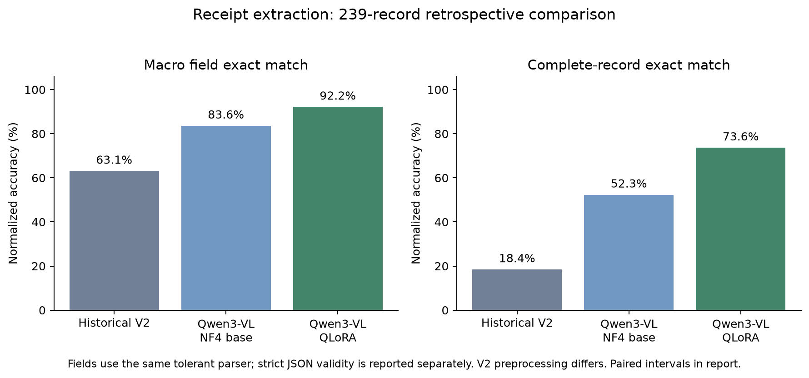

# Qwen3-VL: verified Kaggle experiment

239-record content-disjoint retrospective comparison, not fresh test data. All invalid predictions remain in the denominator.

| Model | Macro field exact | Complete-record exact | Parseable | Strict JSON |
|---|---:|---:|---:|---:|
| Historical V2 | 63.1% | 18.4% | 99.2% | 98.7% |
| Qwen3-VL NF4 base | 83.6% | 52.3% | 100.0% | 0.0% |
| Qwen3-VL QLoRA | 92.2% | 73.6% | 100.0% | 100.0% |

Validation-only choice before evaluation: `qwen_qlora`.

This does not automatically replace V2 or approve the Qwen backend for deployment.

Field accuracy uses the same tolerant parser for every model. Strict JSON compliance is separate; Qwen base code-fence recovery does not count as strict JSON.

Training: 168 optimizer steps on Tesla T4, torch.float16, peak allocated 5523 MiB.

Exported adapter: `checkpoint-112`, selected by minimum validation loss; total run steps are not the selected checkpoint step.

The code and weights are pinned; the training summary records software versions.

## Paired uncertainty

- `qwen_base_minus_v2` macro gain: +20.50 pp; paired image-level 95% interval [+17.15, +23.74] pp; merchant-cluster interval [+16.00, +25.87] pp.
- `qwen_qlora_minus_v2` macro gain: +29.08 pp; paired image-level 95% interval [+25.63, +32.32] pp; merchant-cluster interval [+22.65, +36.00] pp.
- `qwen_qlora_minus_qwen_base` macro gain: +8.58 pp; paired image-level 95% interval [+6.49, +10.67] pp; merchant-cluster interval [+5.52, +12.19] pp.

The evaluation contains 113 normalized merchant groups.
Equal-merchant-weighted macro exact (each observed merchant gets equal weight):
- Historical V2: 56.2%.
- Qwen3-VL NF4 base: 80.0%.
- Qwen3-VL QLoRA: 89.4%.

## Strict output format

- Historical V2: 236/239 strict JSON; 1 additional output(s) parsed by the tolerant parser; methods: {'direct': 1, 'invalid': 2, 'strict_json': 236}.
- Qwen3-VL NF4 base: 0/239 strict JSON; 239 additional output(s) parsed by the tolerant parser; methods: {'code_fence_removed': 239}.
- Qwen3-VL QLoRA: 239/239 strict JSON; 0 additional output(s) parsed by the tolerant parser; methods: {'strict_json': 239}.

## Limits

- Exact-content checks do not rule out perceptual duplicates or pretraining exposure.
- Historical V2 used different image preprocessing and parsing; timings are not paired.
- Paired Qwen base/adapted predictions use the same NF4, images, prompt and decoding.
- No default-model promotion, fresh-data accuracy or production scale claim.
- Image bootstrap assumes independent records; merchant-cluster intervals are also reported, but normalized names may leave merchant aliases ungrouped.

## Fresh export reload check

A fresh Kaggle T4 process reloaded the saved adapter and reproduced the exact base and adapter raw outputs on one fixed validation image. The adapter checksum matched and both outputs required review. This is a one-image reproducibility check, not an accuracy estimate or a general GPU-memory claim.
[Machine-readable reload verification](artifacts/experiments/qwen3_vl/full_run/export_reload_verification.json).

[Bill-by-bill before/after examples](artifacts/experiments/qwen3_vl/full_run/image_comparisons/README.md)

[Legacy V2 versus latest Qwen examples](artifacts/experiments/qwen3_vl/full_run/v2_image_comparisons/README.md)
