# ReceiptOps: fine-tuned receipt extraction

ReceiptOps extracts merchant, address, date and total from receipt images. The
**latest trained model is Qwen3-VL-2B with NF4 QLoRA**, trained on a Kaggle Tesla
T4. It reaches **92.2% macro field exact match, 73.6% complete-record exact match
and 100% strict JSON validity** on the audited 239-image retrospective comparison.

The project includes the trained adapter, saved predictions, reproducible metrics,
comparisons for individual bills, content audits, and a monitored inference API.

[](https://github.com/tusharg007/receipt-kie-vlm/actions/workflows/ci.yml)

[Latest model](models/receipt-kie-qwen3-vl-qlora/README.md) ·
[Full results](QWEN3_VL_RESULTS.md) ·
[Training protocol](KAGGLE_TRAINING.md) ·
[14 output comparisons](artifacts/experiments/qwen3_vl/full_run/portfolio/README.md) ·
[System design](#system-design) ·
[Run the model](#run-the-latest-trained-model)

## Problem and intended workflow

A receipt contains several plausible amounts, dates and business names. Reading
the text is only part of the task: an extractor must select the transaction
total, distinguish it from tax or subtotal, and return a stable contract that
another application can consume.

ReceiptOps learns a four-field extraction task directly from images:

```json
{"company":"CROSS CHANNEL NETWORK SDN. BHD.","address":"47, JALAN MERANTI 1, SEK. 3, BANDAR UTAMA BATANG KALI, 44300 BATANG KALI, SELANGOR.","date":"29/01/2018","total":"6.35"}
```

This is an actual saved Qwen prediction for a
[documented comparison bill](artifacts/experiments/qwen3_vl/full_run/v2_image_comparisons/qwen_complete_record_improvement.png).
The earlier V2 model selected `6.36`; the bill's payable total and reference are
`6.35`. This distinction motivates evaluating field correctness separately from
whether the JSON is valid.

The intended workflow is **receipt image → extraction → schema checks → human
review → recorded feedback**. The project covers model development, reproducible
evaluation and an instrumented serving prototype. Its deployment boundaries are
documented below.

| Layer | Tools |
|---|---|
| Model development | Python, PyTorch, Transformers, PEFT, bitsandbytes |
| Analysis and quality modeling | NumPy, scikit-learn, RapidFuzz, Matplotlib |
| Serving and monitoring | FastAPI, Prometheus, SQLite |
| Reproduction and deployment assets | pytest, Ruff, GitHub Actions, Docker, ECS template |

## Latest results: legacy V2 versus Qwen3-VL QLoRA

All three models are scored on the same **239 content-disjoint retrospective
receipts**. Field accuracy uses the same tolerant parser and normalization;
strict JSON validity is measured separately. Complete-record exact requires all
four fields to match their reference values after normalization.

| Metric | Legacy SmolVLM V2 | Qwen3-VL NF4 base | Latest Qwen3-VL QLoRA |
|---|---:|---:|---:|
| Macro field exact match | 63.1% | 83.6% | **92.2%** |
| Complete-record exact match | 18.4% | 52.3% | **73.6%** |
| Company exact match | 68.6% | 83.3% | **93.3%** |
| Address exact match | 33.9% | 70.7% | **83.7%** |
| Date exact match | 85.4% | 92.1% | **96.2%** |
| Total exact match | 64.4% | 88.3% | **95.4%** |
| Address similarity | 90.7% | 98.1% | **99.0%** |
| Strict four-field JSON validity | 98.7% | 0.0% | **100.0%** |

The latest adapter improves macro exact by **29.08 percentage points over V2**
and **8.58 points over the same Qwen base**. The paired image-bootstrap 95%
interval for the fine-tuning gain is +6.49 to +10.67 points; merchant-cluster
intervals and all raw outputs are in the [results report](QWEN3_VL_RESULTS.md).

The Qwen base wrapped all 239 answers in Markdown code fences. The tolerant
parser recovers those fields for accuracy scoring; those responses do not pass
the strict JSON contract. QLoRA produces direct schema-valid JSON on all 239.
This observed format success does not guarantee correct extracted values.


V2 and Qwen use different architectures, prompts and image preprocessing. The
Qwen base-versus-adapter experiment keeps NF4, images, prompts, pixel limits and
greedy decoding identical, so it isolates the effect of fine-tuning more closely.
This is a retrospective evaluation; fresh-domain performance remains unmeasured.


The address field remains the hardest exact-match target: the latest model
scores 83.7% address exact despite 99.0% normalized address similarity. Long
strings can be nearly correct while still containing a consequential OCR error.

## Output differences: 14 original bills

The expanded gallery contains **14 unique bills**, each with its original image,
saved baseline output, latest Qwen output and dataset reference. Seven compare
V2 with Qwen; seven compare the Qwen base with its QLoRA adapter. They cover
multiple-field recovery, total/date/merchant/address corrections, unchanged
fields and regressions.

These examples are selected to illustrate named outcomes. Within each bucket,
the generator selects the first eligible evaluation ID, avoids repeated bills,
and keeps distinct merchants within each comparison. They do not estimate how
frequently an improvement occurs. Selection rules, candidate counts, raw outputs
and image/figure hashes are recorded in the
[gallery manifest](artifacts/experiments/qwen3_vl/full_run/portfolio/manifest.json).

### Several fields recovered: legacy V2 → Qwen

This bill improves from **2/4 to 4/4 normalized field matches**, recovering the
address and total. Model architecture and preprocessing differ between versions.


### Transaction total corrected: legacy V2 → Qwen

V2 predicts `160.17`; Qwen predicts **`169.80`**, matching the bill's reference.
The merchant is also corrected, taking the record from **2/4 to 4/4**.


### Fine-tuning gain: Qwen base → QLoRA

With the same NF4 base, prompt, image processing and decoding, fine-tuning
selects the payable total **`6.35`** instead of the base's `6.00`, taking this
record from **3/4 to 4/4**. The bill distinguishes the GST summary from the final
payable amount. This comparison controls more variables than the V2-to-Qwen upgrade.


<details>
<summary>More output differences: date, address, unchanged fields and a regression</summary>

**Date selection:** the base returns a promotional date range; QLoRA extracts
the transaction date `20/08/17`. One other field remains incorrect.


**Address recovery:** fine-tuning raises the number of correct fields from
2/4 to 3/4; the bill still needs review.


**Unchanged extracted values:** both Qwen variants have 3/4 normalized matches.
The adapter produces direct JSON, while the base wraps its answer in a code fence.


**Regression:** the base gets all four fields correct; the adapter changes the
address and falls to 3/4. A higher aggregate score does not improve every bill.


**Annotation discrepancy:** this image appears to print `SECTION 26`, while the
SROIE reference says `SECTION 25`. The adapter agrees with the reference; the
base agrees with the visible address. The green address cell measures reference
agreement, so it should not be interpreted as a verified OCR correction. The
total correction from `89.26` to `94.60` is visible on the bill. The reference
is preserved for reproducibility, and this issue does not change the published scores.


</details>

**[Open all 14 full-size comparisons](artifacts/experiments/qwen3_vl/full_run/portfolio/README.md)**.
The earlier [three-merchants gallery](artifacts/experiments/qwen3_vl/full_run/v2_image_comparisons/README.md)
remains available with selection independent of model outcomes. All panels use
saved model outputs; no receipt values are generated for presentation purposes.

## How often did results improve?

Across the full 239-record comparison, count how many of the four fields are
correct on each bill before and after the change:

| Comparison | More correct fields | Equal correct-field count | Fewer correct fields |
|---|---:|---:|---:|
| Legacy V2 → latest Qwen | 167 | 66 | 6 |
| Qwen base → QLoRA | 78 | 151 | 10 |

Equal counts can hide a change in which fields are wrong. Identical normalized
field values occur on 40 bills in the first comparison and 138 in the second.
The latest adapter recovers 58 complete records that the Qwen base misses, while
losing 7 that the base gets right. This yields the net 51-record improvement
from 125/239 to 176/239 complete records.


## System design

The repository has two executable inference paths. The trained Qwen model has
a standalone CLI; the monitored API currently uses the legacy V2 backend.

```mermaid
flowchart TB
    subgraph Q[Latest extractor: implemented Qwen CLI]
        A[Receipt image] --> B[Pinned Qwen image processor]
        B --> C[NF4 base + selected QLoRA adapter]
        C --> D[Greedy generation]
        D --> E[Strict schema validation]
        E --> F[Raw output + fields + review metadata]
    end
    subgraph S[Serving prototype: existing V2 API]
        G[Image request + optional API key] --> H[Size limits + bounded admission]
        H --> I[Persistent V2 model worker]
        I --> J[Schema checks + V2 quality ranking]
        J --> K[Review-required response]
        K --> L[Immutable feedback and export]
        I --> M[Prometheus metrics]
        L --> N[Feature drift and feedback monitoring]
    end
```



The API rejects excess concurrent work with HTTP 429 instead of starting
unbounded model calls. Feedback is stored separately from inference outputs;
export supports a future data-review and retraining cycle. Automatic retraining,
Qwen API integration and production deployment remain future work.

## Engineering decisions and evidence

| Decision | Reason | Evidence |
|---|---|---|
| Exact-content audit before splitting | Different IDs can point to the same image | Seven historical evaluation IDs excluded; [audit and correction](RECEIPTOPS.md) |
| Merchant-disjoint validation | Test checkpoint selection on held-out merchant groups | [445/174 partition manifest](artifacts/experiments/qwen3_vl/full_run/split_manifest.json) |
| NF4 QLoRA with frozen vision/base weights | Adapt a 2B VLM within the T4 budget | [Training code](src/receipt_kie/qwen_cloud.py) and recorded memory |
| Assistant-only training loss | Learn extraction targets without supervising image/user prompt tokens | Collator masking and explicit overflow checks in [cloud trainer](src/receipt_kie/qwen_cloud.py) |
| Separate field accuracy and schema validity | A syntactically valid amount can still be wrong | [Raw-output verifier and paired analysis](scripts/analyze_qwen_experiment.py) |
| Separate quality fit and calibration sets | Measure review policy on labels it did not fit | [Quality experiment](RECEIPTOPS.md); threshold failed to generalize and stays disabled |
| Bounded inference and observable failures | Protect a single worker and expose operational behavior | [FastAPI service](src/receipt_kie/service.py), [monitoring](src/receipt_kie/monitoring.py) and API contract tests |
| Rebuild visual claims from saved outputs | Keep presentation values traceable to model results | [Gallery builder](scripts/build_portfolio_report.py), checksums and CI verification |

## Experiment progression

| Stage | Question explored | Result and decision |
|---|---|---|
| SmolVLM V1 | Can low-resolution LoRA learn the four-field task? | Established the training/JSON pipeline; retained as a baseline |
| Resolution ablation and V2 | Does more image detail improve extraction on a small local GPU? | Continued at 1536 px after memory checks; audited V2 macro exact 63.1% |
| Content and quality audit | Are the comparison and acceptance policy reliable? | Found duplicated content; corrected the evaluation to 239 images and disabled a weak acceptance threshold |
| Qwen NF4 base | How much does a stronger vision-language backbone help? | 83.6% macro exact under the common parser |
| Qwen QLoRA | Does task-specific adaptation improve that same backbone? | 92.2% macro exact and 73.6% complete-record exact; checkpoint 112 selected on validation |

Earlier experiment details remain in the [historical archive](HISTORICAL_V1_V2.md).

## Training and reproducibility

| Item | Completed Qwen experiment |
|---|---|
| Base model | `Qwen/Qwen3-VL-2B-Instruct` |
| Pinned base revision | `89644892e4d85e24eaac8bacfd4f463576704203` |
| Method | NF4 double quantization; rank-16 QLoRA, alpha 32, dropout 0.05 |
| Trainable modules | Language attention and MLP projections; base and vision weights frozen |
| Data | 445 fit / 174 merchant-disjoint validation / 239 retrospective evaluation |
| Training | 3 epochs, 168 optimizer steps, assistant-only loss |
| Selected checkpoint | Step 112, minimum validation loss |
| Hardware | One Tesla T4, native FP16 |
| Peak training memory | 5,523 MiB allocated; 14,258 MiB reserved |
| Mean evaluation inference | Qwen base 8.29 s/image; QLoRA 10.77 s/image on the same T4 |
| Export | 66.6 MiB adapter; processor and base weights download separately |

The measured fine-tuning tradeoff is **+8.58 percentage points macro exact** at
about **+2.48 seconds mean inference time per bill** versus the same Qwen base
(approximately 30% longer). This reflects the evaluated prompts, image cap and
greedy outputs on one T4. It does not measure batched or concurrent serving.

Exact-content duplicates, conflicting labels and incomplete annotations are
excluded or quarantined before partitioning. Merchant groups separate fit and
validation data. The chosen checkpoint and base-versus-adapter decision were
frozen using validation data before evaluating the 239 historical records.

A fresh T4 process reloaded the exported adapter and exactly reproduced the
saved raw outputs for one fixed validation image. It verified the adapter hash,
software versions and review guards. See the
[reload record](artifacts/experiments/qwen3_vl/full_run/export_reload_verification.json).
The [full protocol](KAGGLE_TRAINING.md) records package versions and commands.

## Run the latest trained model

Clone the repository and create a separate CUDA environment for Qwen. Keep its
dependencies separate from the older SmolVLM environment. The following Torch
and torchvision versions match the completed Kaggle run.

```bash
git clone https://github.com/tusharg007/receipt-kie-vlm.git
cd receipt-kie-vlm
python -m venv .venv-qwen
```

Activate with `.venv-qwen\Scripts\activate` on Windows or
`source .venv-qwen/bin/activate` on Linux. Then install and run:

```bash
python -m pip install torch==2.11.0 torchvision==0.26.0 --index-url https://download.pytorch.org/whl/cu128
python -m pip install -r requirements-cloud.txt
python scripts/qwen_inference.py --image assets/demo/synthetic_receipt.png --adapter models/receipt-kie-qwen3-vl-qlora --output .cache/qwen-result.json
```

Use `--image path/to/bill.jpg` for your own receipt. To compare against the
pinned unfine-tuned Qwen base, replace `--adapter ...` with `--base`. Initial
execution requires internet access to download the pinned base and processor.
The fictional demo image requires no SROIE download or Kaggle account.

The command saves raw output, parsed fields, schema errors, runtime metadata and
adapter checksum. Every result includes `review_required=true`. CUDA NF4 is the
measured inference configuration; explicit CPU mode and other memory settings
are described in [the inference guide](KAGGLE_TRAINING.md#optional-single-image-inference).
Training used 5.4 GiB peak allocated memory on a 16 GB T4; this does not establish
compatibility with a 4 GB GPU.

## Model and serving status

| Component | Current status | Entry point |
|---|---|---|
| **Latest trained extractor: Qwen3-VL QLoRA** | Best measured extraction accuracy; standalone inference and fresh reload verified | `scripts/qwen_inference.py` |
| Legacy SmolVLM V2 | Current FastAPI backend and lower-memory demo | `python -m receipt_kie.service` / `scripts/demo_inference.py --model-version v2` |
| Historical SmolVLM V1 | Preserved baseline | `scripts/demo_inference.py --model-version v1` |
| Output-quality ranker | Trained on V2 outputs; automatic acceptance disabled | [Service runbook](RECEIPTOPS.md) |
| Bolt text reviewer | Bounded experimental review workflow; CPU pilot recorded | [Bolt pilot](BOLT_PILOT.md) |

The trained Qwen adapter is available now through its own CLI. Integrating it
into the API requires a Qwen backend and quality-policy calibration on Qwen
outputs. The existing V2 quality classifier cannot be treated as calibrated for
Qwen. Cloud hosting and production load capacity remain unverified.

## Inference API and feedback

The API implements a persistent model, input and pixel limits, bounded
concurrency with HTTP 429 backpressure, optional API-key authentication,
readiness/liveness, Prometheus metrics, SQLite feedback and feature-drift checks.
It currently uses the legacy V2 backend and routes every result to review.

In the separate SmolVLM environment:

```powershell
python -m pip install -r requirements.txt -r requirements-api.txt -r requirements-structured.txt
$env:PYTHONPATH = "src"
python -m receipt_kie.service
```

Send a PNG/JPEG body to `POST /v1/extract` on localhost:8000. See
[RECEIPTOPS.md](RECEIPTOPS.md) for authentication, feedback, monitoring and Docker/ECS
blueprints. A real V2 API smoke request returned HTTP 200 in about 8.3 seconds
at 1024 px. This is one request; production throughput has not been measured.

The V2 quality ranker achieved retrospective AP 0.275 against prevalence 0.184.
Its threshold did not generalize from calibration to evaluation, so automatic
acceptance stays disabled. These quality-model metrics do not describe Qwen OCR
accuracy and are not reused as Qwen confidence scores.

## Type-safe generation

The optional V2 schema decoder constrains output to four string fields. A native
TypeLLM/SGLang integration supports nullable fields, dependency-aware checks,
optional thinking and permutation averaging. See
[TYPE_SAFE_EXTRACTION.md](TYPE_SAFE_EXTRACTION.md) for setup and measured limits.
Qwen's accuracy gains here come from the model and QLoRA training; the current
Qwen experiment used greedy generation followed by strict validation. JSON
compliance and correct OCR are evaluated separately throughout.

## Evaluation boundaries

- The 239 receipts are the content-audited retrospective subset. Seven of the
  original 246 IDs were excluded for duplicated train/prior-evaluation content.
- Exact hashing does not rule out perceptual duplicates, merchant-name aliases
  or exposure during base-model pretraining.
- The latest adapter still misses at least one normalized field on 26.4% of
  these records. Review remains necessary.
- SROIE results do not establish accuracy on multilingual or private bills.
  Additional domain data, quality calibration, hosting and load measurements are
  needed for a production deployment.

## Verification and project history

The local unit/API suite has **98 passing tests**. GitHub CI runs lint, tests,
quality-model reproduction, Qwen metric/selection reproduction, gallery audits
and dependency checks without downloading model weights or using a GPU.

```bash
python -m pip install -r requirements-dev.txt
python -m pytest -q -p no:cacheprovider
python -m ruff check src scripts tests
python scripts/integrity_check.py
python scripts/build_portfolio_report.py --verify-only
```

Use the existing development environment for these CPU checks. Model inference
uses the separate environments documented above.

To rebuild the 14 gallery panels and diagnostic charts, obtain the original
SROIE images under `data/raw/sroie/SROIE2019`, then run:

```bash
python scripts/build_portfolio_report.py
```

`--verify-only` needs only the committed outputs: it recomputes all-record
outcomes and deterministic example selection, compares displayed fields and raw
responses with their sources, and checks each panel's SHA-256. It therefore
catches stale or edited visual evidence without accessing the raw dataset.

## Implementation map

| Component | Source |
|---|---|
| Dataset cleaning and grouped partitions | [cloud_data.py](src/receipt_kie/cloud_data.py) |
| Qwen training, masking and paired evaluation | [qwen_cloud.py](src/receipt_kie/qwen_cloud.py) |
| Latest-model single-image inference | [qwen_inference.py](scripts/qwen_inference.py) |
| Parsing, normalization and schema contracts | [metrics.py](src/receipt_kie/metrics.py), [structured.py](src/receipt_kie/structured.py) |
| Output-quality model and monitoring | [quality.py](src/receipt_kie/quality.py), [monitoring.py](src/receipt_kie/monitoring.py) |
| API admission, lifecycle and review workflow | [service.py](src/receipt_kie/service.py) |
| Verified analysis and visual evidence | [analyze_qwen_experiment.py](scripts/analyze_qwen_experiment.py), [build_portfolio_report.py](scripts/build_portfolio_report.py) |
| Model weights and provenance | [Latest adapter package](models/receipt-kie-qwen3-vl-qlora/README.md) |

## Next experiments

| Work item | Evidence needed before claiming completion |
|---|---|
| Fresh-domain evaluation | Independently labeled bills from new layouts/merchants; frozen comparison and failure slices |
| Qwen in the API | Backend integration, lifecycle/memory measurements, and a review policy calibrated on Qwen outputs |
| Hosted serving | Executed deployment, authenticated requests, load/error measurements and durable shared state |

## Documentation

| Documentation | Contents |
|---|---|
| [Qwen results](QWEN3_VL_RESULTS.md) | Latest metrics, paired uncertainty, raw predictions and galleries |
| [14-case output gallery](artifacts/experiments/qwen3_vl/full_run/portfolio/README.md) | Corrections, unchanged outputs, regressions and selection manifest |
| [Kaggle training](KAGGLE_TRAINING.md) | Data protocol, pinned software, training and inference commands |
| [Model versions](MODEL_COMPARISON.md) | Current adapter registry and version comparison |
| [Historical V1/V2 experiments](HISTORICAL_V1_V2.md) | Archived old tables, plots, ablations and failure panels |
| [V2 training report](HIGH_RESOLUTION_TRAINING_V2.md) | Historical 1536 px SmolVLM experiment |
| [Content and quality audit](RECEIPTOPS.md) | Leakage correction, quality ranker and review policy |

All three adapters are committed under `models/`. Saved Qwen predictions,
training metadata and galleries are under `artifacts/experiments/qwen3_vl/full_run/`.
Raw SROIE images, training checkpoints, credential files and local caches are
Git-ignored. The external dataset is obtained separately; the model's base
Apache-2.0 license is included with the Qwen adapter package. Use receipt data
whose terms permit processing and review extracted financial values before use.
