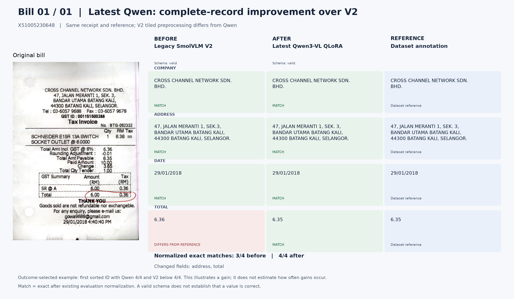
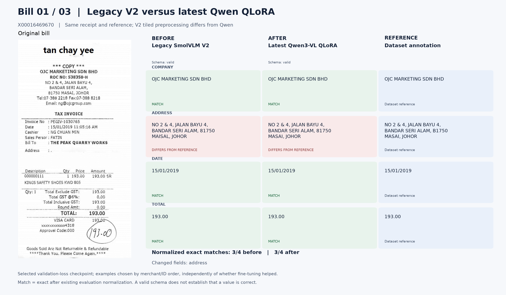
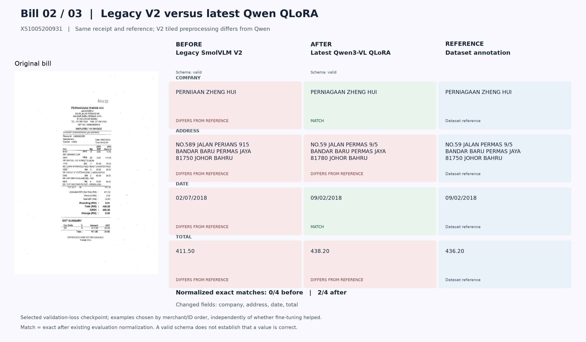
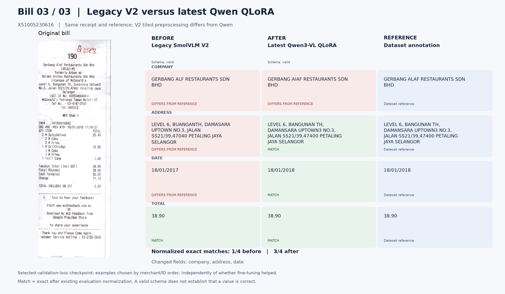

# ReceiptOps: fine-tuned receipt extraction

ReceiptOps extracts merchant, address, date and total from receipt images. The
**latest trained model is Qwen3-VL-2B with NF4 QLoRA**, trained on a Kaggle Tesla
T4. It reaches **92.2% macro field exact match, 73.6% complete-record exact match
and 100% strict JSON validity** on the audited 239-image retrospective comparison.

The project includes the trained adapter, saved predictions, reproducible metrics,
comparisons for individual bills, content audits, and a monitored inference API.

[](https://github.com/tusharg007/receipt-kie-vlm/actions/workflows/ci.yml)

[Latest model](models/receipt-kie-qwen3-vl-qlora/README.md) ·
[Full results](QWEN3_VL_RESULTS.md) ·
[Training protocol](KAGGLE_TRAINING.md) ·
[Model versions](MODEL_COMPARISON.md)

## Latest results: legacy V2 versus Qwen3-VL QLoRA

All three models are scored on the same **239 content-disjoint retrospective
receipts**. Field accuracy uses the same tolerant parser and normalization;
strict JSON validity is measured separately. Complete-record exact requires all
four fields to match their reference values after normalization.

| Metric | Legacy SmolVLM V2 | Qwen3-VL NF4 base | Latest Qwen3-VL QLoRA |
|---|---:|---:|---:|
| Macro field exact match | 63.1% | 83.6% | **92.2%** |
| Complete-record exact match | 18.4% | 52.3% | **73.6%** |
| Company exact match | 68.6% | 83.3% | **93.3%** |
| Address exact match | 33.9% | 70.7% | **83.7%** |
| Date exact match | 85.4% | 92.1% | **96.2%** |
| Total exact match | 64.4% | 88.3% | **95.4%** |
| Address similarity | 90.7% | 98.1% | **99.0%** |
| Strict four-field JSON validity | 98.7% | 0.0% | **100.0%** |

The latest adapter improves macro exact by **29.08 percentage points over V2**
and **8.58 points over the same Qwen base**. The paired image-bootstrap 95%
interval for the fine-tuning gain is +6.49 to +10.67 points; merchant-cluster
intervals and all raw outputs are in the [results report](QWEN3_VL_RESULTS.md).

The Qwen base wrapped all 239 answers in Markdown code fences. The tolerant
parser recovers those fields for accuracy scoring; those responses do not pass
the strict JSON contract. QLoRA produces direct schema-valid JSON on all 239.
This observed format success does not guarantee correct extracted values.


V2 and Qwen use different architectures, prompts and image preprocessing. The
Qwen base-versus-adapter experiment keeps NF4, images, prompts, pixel limits and
greedy decoding identical, so it isolates the effect of fine-tuning more closely.
This is a retrospective evaluation; fresh-domain performance remains unmeasured.

## Original bill, legacy V2 output, latest Qwen output

These panels use saved model predictions. They show the original bill, both
versions' extracted values and the dataset annotation. The first three distinct
merchants in sorted evaluation-ID order were selected independently of outcomes;
all three examples are included, including remaining errors. Dataset annotations
can also contain OCR errors.

The example below is the first sorted evaluation ID where Qwen gets all four
normalized fields correct and V2 misses at least one. It illustrates a complete
record improvement; its selection is based on that outcome.



<details>
<summary>Three additional bills selected independently of model outcomes</summary>







</details>

See the [V2-to-Qwen gallery and prediction manifest](artifacts/experiments/qwen3_vl/full_run/v2_image_comparisons/README.md).
For the controlled fine-tuning comparison, see the separate
[Qwen base-to-QLoRA gallery](artifacts/experiments/qwen3_vl/full_run/image_comparisons/README.md).
All images in these two galleries use the latest saved Qwen adapter outputs.

## Training and reproducibility

| Item | Completed Qwen experiment |
|---|---|
| Base model | `Qwen/Qwen3-VL-2B-Instruct` |
| Pinned base revision | `89644892e4d85e24eaac8bacfd4f463576704203` |
| Method | NF4 double quantization; rank-16 QLoRA, alpha 32, dropout 0.05 |
| Trainable modules | Language attention and MLP projections; base and vision weights frozen |
| Data | 445 fit / 174 merchant-disjoint validation / 239 retrospective evaluation |
| Training | 3 epochs, 168 optimizer steps, assistant-only loss |
| Selected checkpoint | Step 112, minimum validation loss |
| Hardware | One Tesla T4, native FP16 |
| Peak training memory | 5,523 MiB allocated; 14,258 MiB reserved |
| Mean evaluation inference | Qwen base 8.29 s/image; QLoRA 10.77 s/image on the same T4 |
| Export | 66.6 MiB adapter; processor and base weights download separately |

Exact-content duplicates, conflicting labels and incomplete annotations are
excluded or quarantined before partitioning. Merchant groups separate fit and
validation data. The chosen checkpoint and base-versus-adapter decision were
frozen using validation data before evaluating the 239 historical records.

A fresh T4 process reloaded the exported adapter and exactly reproduced the
saved raw outputs for one fixed validation image. It verified the adapter hash,
software versions and review guards. See the
[reload record](artifacts/experiments/qwen3_vl/full_run/export_reload_verification.json).
The [full protocol](KAGGLE_TRAINING.md) records package versions and commands.

## Run the latest trained model

Clone the repository and create a separate CUDA environment for Qwen. Keep its
dependencies separate from the older SmolVLM environment. The following Torch
and torchvision versions match the completed Kaggle run.

```bash
git clone https://github.com/tusharg007/receipt-kie-vlm.git
cd receipt-kie-vlm
python -m venv .venv-qwen
```

Activate with `.venv-qwen\Scripts\activate` on Windows or
`source .venv-qwen/bin/activate` on Linux. Then install and run:

```bash
python -m pip install torch==2.11.0 torchvision==0.26.0 --index-url https://download.pytorch.org/whl/cu128
python -m pip install -r requirements-cloud.txt
python scripts/qwen_inference.py --image assets/demo/synthetic_receipt.png --adapter models/receipt-kie-qwen3-vl-qlora --output .cache/qwen-result.json
```

Use `--image path/to/bill.jpg` for your own receipt. To compare against the
pinned unfine-tuned Qwen base, replace `--adapter ...` with `--base`. Initial
execution requires internet access to download the pinned base and processor.
The fictional demo image requires no SROIE download or Kaggle account.

The command saves raw output, parsed fields, schema errors, runtime metadata and
adapter checksum. Every result includes `review_required=true`. CUDA NF4 is the
measured inference configuration; explicit CPU mode and other memory settings
are described in [the inference guide](KAGGLE_TRAINING.md#optional-single-image-inference).
Training used 5.4 GiB peak allocated memory on a 16 GB T4; this does not establish
compatibility with a 4 GB GPU.

## Model and serving status

| Component | Current status | Entry point |
|---|---|---|
| **Latest trained extractor: Qwen3-VL QLoRA** | Best measured extraction accuracy; standalone inference and fresh reload verified | `scripts/qwen_inference.py` |
| Legacy SmolVLM V2 | Current FastAPI backend and lower-memory demo | `python -m receipt_kie.service` / `scripts/demo_inference.py --model-version v2` |
| Historical SmolVLM V1 | Preserved baseline | `scripts/demo_inference.py --model-version v1` |
| Output-quality ranker | Trained on V2 outputs; automatic acceptance disabled | [Service runbook](RECEIPTOPS.md) |
| Bolt text reviewer | Bounded experimental review workflow; CPU pilot recorded | [Bolt pilot](BOLT_PILOT.md) |

The trained Qwen adapter is available now through its own CLI. Integrating it
into the API requires a Qwen backend and quality-policy calibration on Qwen
outputs. The existing V2 quality classifier cannot be treated as calibrated for
Qwen. Cloud hosting and production load capacity remain unverified.

## Inference API and feedback

The API implements a persistent model, input and pixel limits, bounded
concurrency with HTTP 429 backpressure, optional API-key authentication,
readiness/liveness, Prometheus metrics, SQLite feedback and feature-drift checks.
It currently uses the legacy V2 backend and routes every result to review.

In the separate SmolVLM environment:

```powershell
python -m pip install -r requirements.txt -r requirements-api.txt -r requirements-structured.txt
$env:PYTHONPATH = "src"
python -m receipt_kie.service
```

Send a PNG/JPEG body to `POST /v1/extract` on localhost:8000. See
[RECEIPTOPS.md](RECEIPTOPS.md) for authentication, feedback, monitoring and Docker/ECS
blueprints. A real V2 API smoke request returned HTTP 200 in about 8.3 seconds
at 1024 px. This is one request; production throughput has not been measured.

The V2 quality ranker achieved retrospective AP 0.275 against prevalence 0.184.
Its threshold did not generalize from calibration to evaluation, so automatic
acceptance stays disabled. These quality-model metrics do not describe Qwen OCR
accuracy and are not reused as Qwen confidence scores.

## Type-safe generation

The optional V2 schema decoder constrains output to four string fields. A native
TypeLLM/SGLang integration supports nullable fields, dependency-aware checks,
optional thinking and permutation averaging. See
[TYPE_SAFE_EXTRACTION.md](TYPE_SAFE_EXTRACTION.md) for setup and measured limits.
Qwen's accuracy gains here come from the model and QLoRA training; the current
Qwen experiment used greedy generation followed by strict validation. JSON
compliance and correct OCR are evaluated separately throughout.

## Evaluation boundaries

- The 239 receipts are the content-audited retrospective subset. Seven of the
  original 246 IDs were excluded for duplicated train/prior-evaluation content.
- Exact hashing does not rule out perceptual duplicates, merchant-name aliases
  or exposure during base-model pretraining.
- The latest adapter still misses at least one normalized field on 26.4% of
  these records. Review remains necessary.
- SROIE results do not establish accuracy on multilingual or private bills.
  Additional domain data, quality calibration, hosting and load measurements are
  needed for a production deployment.

## Verification and project history

The local unit/API suite has **97 passing tests**. GitHub CI runs lint, tests,
quality-model reproduction, Qwen metric/selection reproduction and dependency
checks without downloading model weights or using a GPU.

```bash
python -m pip install -r requirements-dev.txt
python -m pytest -q -p no:cacheprovider
python -m ruff check src scripts tests
python scripts/integrity_check.py
```

Use the existing development environment for these CPU checks. Model inference
uses the separate environments documented above.

| Documentation | Contents |
|---|---|
| [Qwen results](QWEN3_VL_RESULTS.md) | Latest metrics, paired uncertainty, raw predictions and galleries |
| [Kaggle training](KAGGLE_TRAINING.md) | Data protocol, pinned software, training and inference commands |
| [Model versions](MODEL_COMPARISON.md) | Current adapter registry and version comparison |
| [Historical V1/V2 experiments](HISTORICAL_V1_V2.md) | Archived old tables, plots, ablations and failure panels |
| [V2 training report](HIGH_RESOLUTION_TRAINING_V2.md) | Historical 1536 px SmolVLM experiment |
| [Content and quality audit](RECEIPTOPS.md) | Leakage correction, quality ranker and review policy |

All three adapters are committed under `models/`. Saved Qwen predictions,
training metadata and galleries are under `artifacts/experiments/qwen3_vl/full_run/`.
Raw SROIE images, training checkpoints, credential files and local caches are
Git-ignored. The external dataset is obtained separately; the model's base
Apache-2.0 license is included with the Qwen adapter package. Use receipt data
whose terms permit processing and review extracted financial values before use.
