# ReceiptOps: quality-aware receipt ML

A document ML project combining fine-tuned receipt extraction, content-leakage
auditing, an imbalance-aware quality classifier, and an instrumented inference API.
The original ReceiptKIE-VLM training pipeline and V1/V2 adapters remain available.

ReceiptKIE-VLM takes a receipt image and generates JSON with exactly four SROIE
entities:

```json
{"company":"...","address":"...","date":"...","total":"..."}
```

This repository contains a structured-KIE pipeline, two versioned LoRA adapters,
and auditable evaluation artifacts. V2 is the recommended high-resolution model
under `models/receipt-kie-lora-v2-highres/`; the original V1 adapter remains
under `models/receipt-kie-lora/` as a reproducible historical baseline. SmolVLM
was not trained from scratch.

## Current evidence and limitations

An October 2026 SHA-256 content audit found duplicates that earlier ID-only
checks missed. Of the original 246 evaluation IDs, four duplicate official-train
images, two duplicate previously evaluated test images, and one repeats another
evaluation image. The corrected **239-image, content-disjoint retrospective
subset** retains V2's improvement; it is not a new untouched test set.

| Normalized metric | V1 | V2 |
|---|---:|---:|
| Macro field exact match | 43.8% | 63.1% |
| Complete-record exact match | 4.2% | 18.4% |
| Company exact match | 52.3% | 68.6% |
| Date exact match | 63.6% | 85.4% |
| Total exact match | 43.5% | 64.4% |
| Address similarity | 82.2% | 90.7% |

One incomplete validation annotation is quarantined. The quality classifier uses
46 fit records and 16 separate calibration records. On the 239 retrospective
evaluation records, it achieves **0.275 average precision** against a **0.184
prevalence baseline**. A candidate threshold reaches 80% precision on calibration
but only 37.0% on evaluation. Promotion is disabled: the shipped service routes
**every** receipt to review. The ranker does not correct OCR or supply calibrated
confidence.

- **Implemented:** persistent-model FastAPI service, request size/pixel limits,
  bounded inference concurrency with HTTP 429 backpressure, API-key support,
  readiness/liveness, Prometheus metrics, local SQLite feedback, feature drift
  checks, and explicit feedback export.
- **Measured:** a real V2 API smoke request on the fictional demo returned HTTP
  200 in about 8.3 seconds at 1024 px and was routed to review. This is one
  in-process ASGI request, not a load or production throughput benchmark.
- **Bolt integration:** a bounded text-review agent with a read-only diagnostic
  tool and schema-constrained decisions, tested with the official Q4_K_M model
  on CPU. An experimental CPU-OCR → Bolt challenger scored 33.3% versus V2's
  25.0% macro exact on three fixed development bills, with no complete-record
  successes and one token-budget failure. This tiny pilot does not justify
  replacing V2. See [the full Bolt pilot](BOLT_PILOT.md). The verified checkpoint
  declares text/text; direct vision and 4GB GPU fit were not tested.
- **Deployment assets:** Dockerfile, AWS ECS template and GitHub Actions workflow;
  these files do not constitute an executed cloud deployment or a passing remote
  CI run. SQLite and one GPU worker are a single-replica prototype.

Start with [the service runbook](RECEIPTOPS.md),
[type-safe extraction](TYPE_SAFE_EXTRACTION.md), and the
[Bolt development pilot](BOLT_PILOT.md). Full corrected results:
[`content_disjoint_results.json`](artifacts/experiments/receiptops/content_disjoint_results.json).

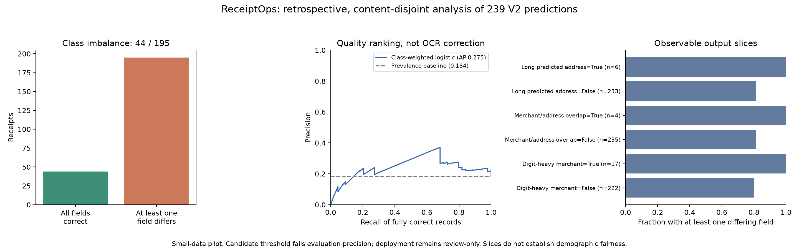

## Larger-model training on Kaggle

An isolated [Qwen3-VL-2B QLoRA training package](KAGGLE_TRAINING.md) now supports
private Kaggle GPU jobs, a real optimizer-step smoke test, merchant-disjoint
validation, and paired quantized-base versus adapted-model evaluation. The
current protocol uses 445 fit images, 174 validation images and the 239-record
historical retrospective comparison. It does not upgrade the local V2 dependency
stack or replace the service model. Submitted jobs are not accuracy results;
verified metrics will be published only after training and evaluation finish.

## Run the inference service

Install the existing VLM environment, the API, and constrained-decoding dependencies:

```powershell
python -m pip install -r requirements.txt -r requirements-api.txt -r requirements-structured.txt
$env:PYTHONPATH = "src"
python -m receipt_kie.service
```

The API binds to localhost:8000 by default. Send a PNG/JPEG request body to
`POST /v1/extract`; inspect `/health/ready`, `/metrics`, and `/v1/monitoring`.
The default 1024 px setting reduces memory use and routes results to review.
See [the runbook](RECEIPTOPS.md) for authentication, feedback, configuration,
monitoring and deployment instructions.

Local validation: **91 unit and API contract tests pass**, with clean Ruff and
dependency checks. Reproduce with:

```powershell
python -m pip install -r requirements-dev.txt
python -m pytest -q -p no:cacheprovider
python -m ruff check src scripts tests
python -m pip check
```

[](https://github.com/tusharg007/receipt-kie-vlm/actions/workflows/ci.yml)

## Clone and Run the Trained Model

```bash
git clone https://github.com/tusharg007/receipt-kie-vlm.git
cd receipt-kie-vlm
python -m venv .venv
```

Windows:

```powershell
.\.venv\Scripts\activate
```

Linux/macOS:

```bash
source .venv/bin/activate
```

Then install and run:

```bash
python -m pip install --upgrade pip
pip install -r requirements.txt
python scripts/verify_installation.py
python scripts/demo_inference.py --model-version v2
```

V2 is the default. To reproduce V1 or use another image:

```bash
python scripts/demo_inference.py --model-version v1
python scripts/demo_inference.py --image path/to/receipt.png
```

Both trained LoRA adapters are stored directly in this repository. On first use,
the public `HuggingFaceTB/SmolVLM-256M-Instruct` base model and processor download
automatically, so internet access is required for that initial run. GPU inference
is recommended but optional; the demo falls back to CPU. Inference uses the
fictional image in `assets/demo/` and requires neither SROIE nor a Kaggle account.
Training and evaluation require the separately obtained SROIE dataset.
`assets/demo/expected_output.json` documents the fictional text rendered in the
image; it is not a promise that this small research model predicts every field
exactly.

## Type-safe extraction (optional)

Constrain the existing V2 adapter to its four-field JSON Schema during generation:

```bash
pip install -r requirements-structured.txt
python scripts/demo_inference.py --structured --image path/to/receipt.jpg
```

Strict schema validation rejects incomplete or incorrectly typed outputs; review
signals flag missing fields and suspicious dates/amounts. Schema compliance does
not guarantee correct OCR. On limited GPU memory, explicitly add
`--image-longest-edge 1024` (this changes image detail).

A separate native TypeLLM/SGLang integration adds nullable typed fields, a
dependency-aware check of the total's source, optional thinking, and permutation
averaging for that check. TypeLLM requires a separate environment because its
Transformers dependency conflicts with the pinned training stack.
See [setup, limitations, and paired validation](TYPE_SAFE_EXTRACTION.md).

## Research Progression

### Iteration 1 — Low-resolution LoRA baseline

V1 used ID-disjoint training at a 512 px longest edge with rank-16 LoRA on the
attention projections. Its original 563/63 official-train split, 100-receipt
official-test evaluation, raw predictions, plots, and limitations are retained
unchanged so the development path remains reproducible. Those historical V1
results appear later in this README.

### Resolution Ablation

A fixed 30-receipt inference-development subset compared 512, 1024, 1536, and
2048 px processing plus token-budget and two-pass variants. It showed strong
2048 px inference gains, but it was explicitly a development experiment rather
than final untouched-test evidence. A subsequent 2048 px training smoke test
completed but reached 3,943 MiB allocated VRAM, exceeding the predefined
3.7 GiB safety threshold on the 4 GiB GPU. The 1536 px smoke test used 3,132 MiB
and retained a 657 MiB safety margin, so 1536 px was frozen for continued
training. Repetition penalty was selected later on validation data, not on the
ablation subset.

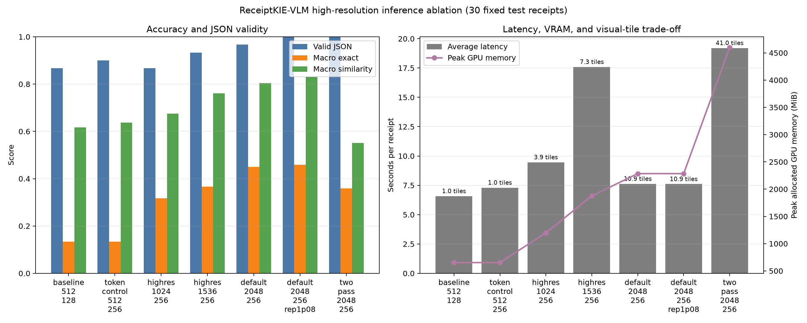

### Iteration 2 — Historical high-resolution comparison

The 246-ID results below are retained as historical evidence. Use the corrected
239-image content audit above for current reporting.

V2 continued from V1 for three additional epochs and 210 optimizer steps using
1536 px tiled images, a 512 px maximum patch edge, image splitting, and the same
four-field JSON target. Checkpoint 210 and deterministic 256-token generation
with repetition penalty 1.08 were selected using only 63 official-train
validation receipts. The original comparison used 246 official-test IDs absent
from prior artifacts; the subsequent content audit found duplicates across IDs.

| Metric | Base | V1 | V2 | V2 − V1 |
|---|---:|---:|---:|---:|
| Valid JSON | 41.5% | 98.4% | **99.2%** | +0.8 pp |
| Company exact | 8.1% | 52.4% | **69.1%** | +16.7 pp |
| Address similarity | 12.2% | 82.2% | **90.7%** | +8.5 pp |
| Date exact | 15.4% | 63.4% | **85.8%** | +22.4 pp |
| Total exact | 0.4% | 43.9% | **64.6%** | +20.7 pp |
| Complete-record exact | 0.0% | 4.1% | **18.3%** | +14.2 pp |
| Macro exact | 6.2% | 43.9% | **63.3%** | +19.4 pp |

Address uses normalized similarity. Company, date, total, and macro field
results use normalized exact match. Complete-record exact requires all four
fields to be correct after normalization.

High-resolution V2 continued adaptation achieved 99.2% valid JSON, 69.1%
company exact match, 90.7% address similarity, 85.8% date exact match, 64.6%
total exact match and 18.3% complete-record exact match on the historical 246-ID
SROIE evaluation. These figures predate the content-leakage audit.

Paired 2,000-resample bootstrap intervals support the main gains:

| V2 − V1 metric | Point change | 95% CI |
|---|---:|---:|
| Macro exact | +19.41 pp | +16.26 to +22.76 pp |
| Complete-record exact | +14.23 pp | +10.16 to +19.11 pp |
| Address similarity | +8.52 pp | +6.01 to +11.01 pp |
| Valid JSON | +0.81 pp | −1.22 to +2.85 pp |

The equal-setting inference comparison used about 1,877 MiB peak allocated VRAM
for both adapters. Median latency increased from 10.27 s for V1 to 10.74 s for
V2; averages were affected by laptop power-throttling intervals. Training used
3,174 MiB peak allocated VRAM and completed in 84.37 minutes.

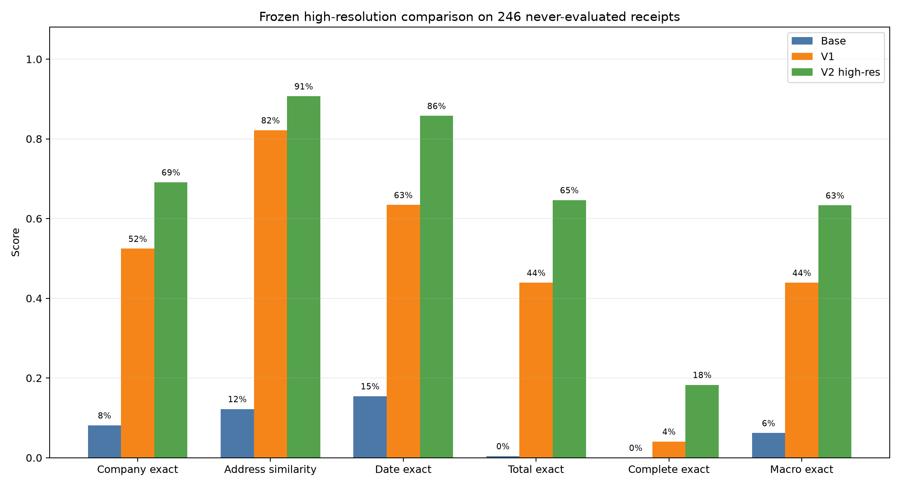

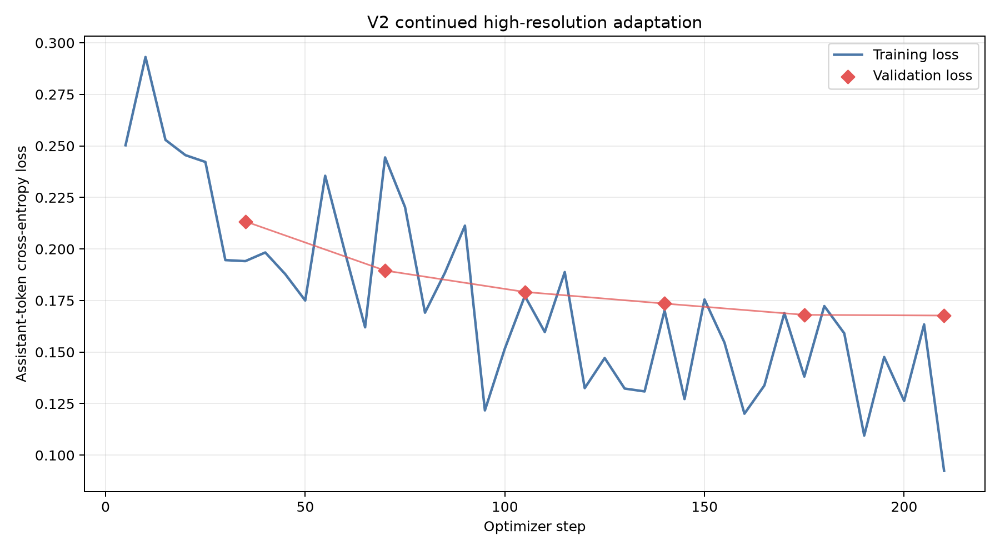

The qualitative panels follow documented first-match selection rules and include
both gains and a regression:

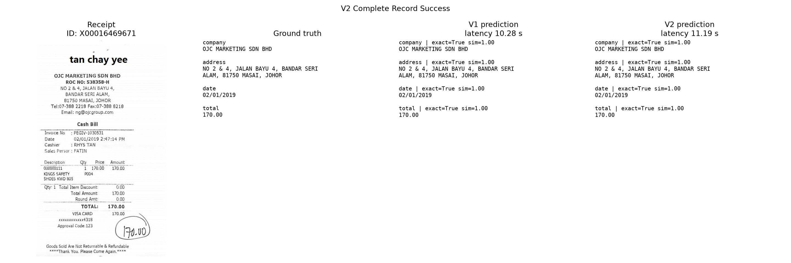

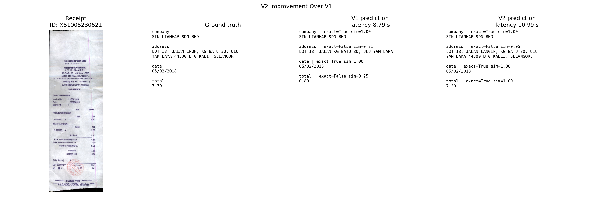

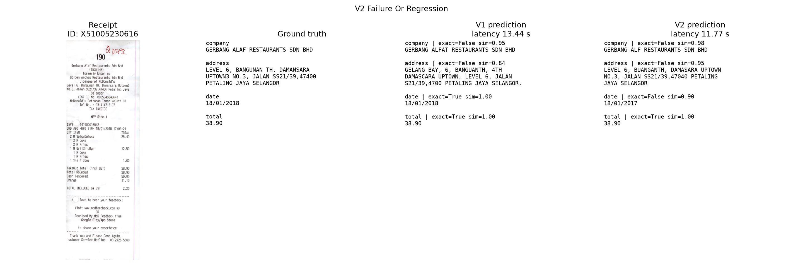

V2 remains a research prototype rather than a production financial extractor.
See [`MODEL_COMPARISON.md`](MODEL_COMPARISON.md),
[`HIGH_RESOLUTION_ABLATION.md`](HIGH_RESOLUTION_ABLATION.md), and
[`HIGH_RESOLUTION_TRAINING_V2.md`](HIGH_RESOLUTION_TRAINING_V2.md) for the
versioning, development evidence, and full release analysis.

## Problem statement

Conventional receipt OCR returns an undifferentiated stream of text. Applications
usually need named values: the merchant, address, transaction date, and amount.
ReceiptKIE-VLM formulates that task as multimodal supervised fine-tuning (SFT):
the model sees the image and extraction instruction, then learns to generate one
canonical JSON object. This combines visual reading, field selection, and
serialization in one model while retaining auditable raw predictions.

## Architecture

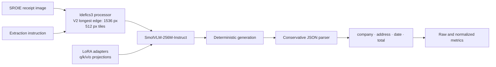

The base model is
[`HuggingFaceTB/SmolVLM-256M-Instruct`](https://huggingface.co/HuggingFaceTB/SmolVLM-256M-Instruct).
PEFT LoRA updates only attention projection adapters; the base weights remain
frozen.

## Dataset and audit

The experiment uses SROIE2019 entity annotations from the public
[`urbikn/sroie-datasetv2`](https://www.kaggle.com/datasets/urbikn/sroie-datasetv2)
mirror. SROIE is an external dataset and is not owned by this project. Raw data is
Git-ignored.

| Audit item | Result |
|---|---:|
| Valid image/entity pairs | 973 |
| Training receipts | 626 |
| Test receipts | 347 |
| Missing/invalid pairs excluded | 0 |
| Empty address values | 1 |
| Empty total values | 1 |
| Image width range | 435–4,961 px |
| Image height range | 605–7,016 px |

The complete audit, including field frequencies and dimension statistics, is in
[`artifacts/reports/dataset_audit.md`](artifacts/reports/dataset_audit.md).

Targets preserve annotation values as strings and use stable key order, UTF-8,
compact separators, and `""` for missing values. No OCR transcription generated
by another model is used as the KIE target.

## Multimodal SFT and label masking

Each sample uses the processor's native chat template:

- System: define the receipt-extraction role.
- User: one receipt image plus an instruction to emit JSON only.
- Assistant: canonical ground-truth JSON.

The collator processes the prompt and full conversation separately, finds their
token prefix boundary, and masks prompt, padding, and image placeholder tokens
with `-100`. Loss therefore applies only to assistant answer tokens. The real-model
smoke test observed 146 prompt tokens and 91–98 assistant tokens, well below the
configured 512-token sequence limit; image tokens were not truncated.

## LoRA configuration

LoRA adds low-rank trainable matrices to `q_proj`, `k_proj`, `v_proj`, and
`o_proj`. Valid module suffixes are discovered from the loaded architecture before
attachment rather than assumed blindly.

| Setting | Value |
|---|---|
| Base model | SmolVLM-256M-Instruct |
| LoRA rank / alpha / dropout | 16 / 32 / 0.05 |
| Trainable parameters | 2,727,936 |
| Trainable share | 1.052% |
| Total parameters with adapters | 259,212,864 |
| Estimated FP32 adapter size | 10.41 MiB |

## Historical V1 hardware and training

| Setting | Value |
|---|---|
| GPU | NVIDIA GeForce RTX 3050 Laptop GPU, 4 GiB |
| PyTorch / CUDA | 2.5.1+cu124 / CUDA 12.4 |
| Precision | BF16 |
| Attention | Eager fallback; this Idefics3 vision tower rejected SDPA |
| Image size | Processor-supported 512 px longest edge |
| Batch / accumulation | 1 / 8 |
| Epochs / optimizer steps | 2 / 140 |
| Learning rate / warmup | 2e-4 / 5% |
| Training receipts | 563 from the official train split |
| Validation-loss receipts | 63 disjoint receipts from the official train split |
| Final evaluation receipts | 100 sampled only from the official test split |
| Seed | 42 |
| Duration | 1,084.19 s (18.07 min) |
| Peak allocated training VRAM | 827.32 MiB |

Validation loss decreased from **1.3650** at step 35 to **1.0618** at step 70,
**0.9373** at step 105, and **0.9034** at the completed step 140. Training and
validation IDs are stored in the generated split manifest with zero overlap.
The official test split was not used for model selection. The saved checksum
confirms at least one LoRA tensor changed from its fresh initialization.

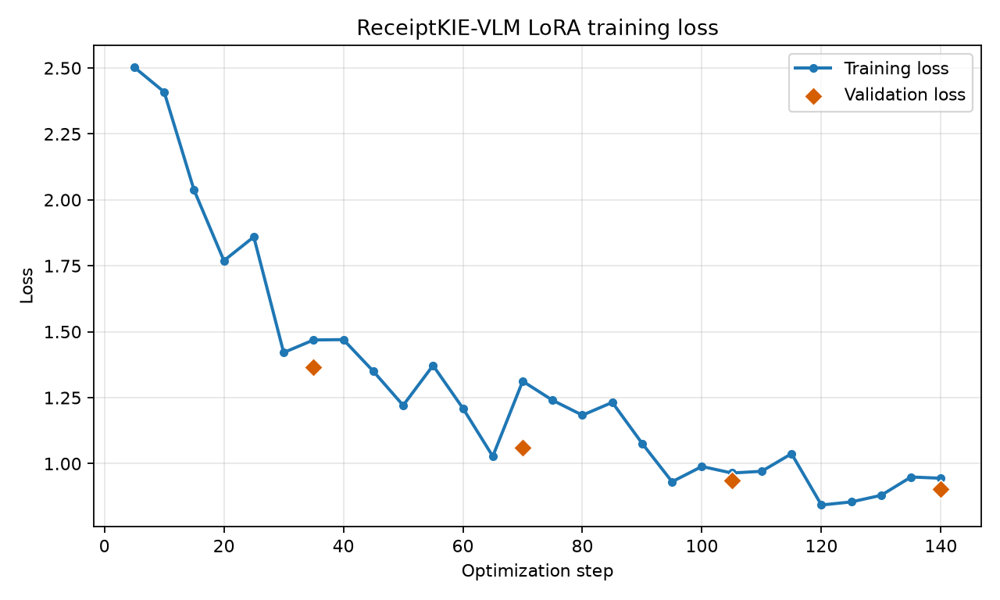

## Historical V1 base versus LoRA results

These retained Iteration 1 results used the same fixed 100-receipt subset from the
official test split, with the same prompt, 512 px image processing,
deterministic decoding, and 128-new-token limit.

| Metric | Base | LoRA | Absolute change |
|---|---:|---:|---:|
| Valid JSON | 19% | **85%** | +66 pp |
| Company normalized exact match | 1% | **26%** | +25 pp |
| Address normalized similarity | 2.75% | **51.92%** | +49.17 pp |
| Date normalized exact match | 1% | **18%** | +17 pp |
| Total normalized exact match | 0% | **25%** | +25 pp |
| Complete-record normalized exact match | 0% | 0% | 0 pp |
| Average latency | 5.895 s | 7.640 s | +1.745 s |
| Median latency | 5.458 s | 7.440 s | +1.982 s |
| Peak allocated inference VRAM | 642.70 MiB | 653.17 MiB | +10.47 MiB |

Raw versus normalized field metrics are retained in
[`base_metrics.json`](artifacts/reports/base_metrics.json),
[`lora_metrics.json`](artifacts/reports/lora_metrics.json), and
[`model_comparison.csv`](artifacts/reports/model_comparison.csv).

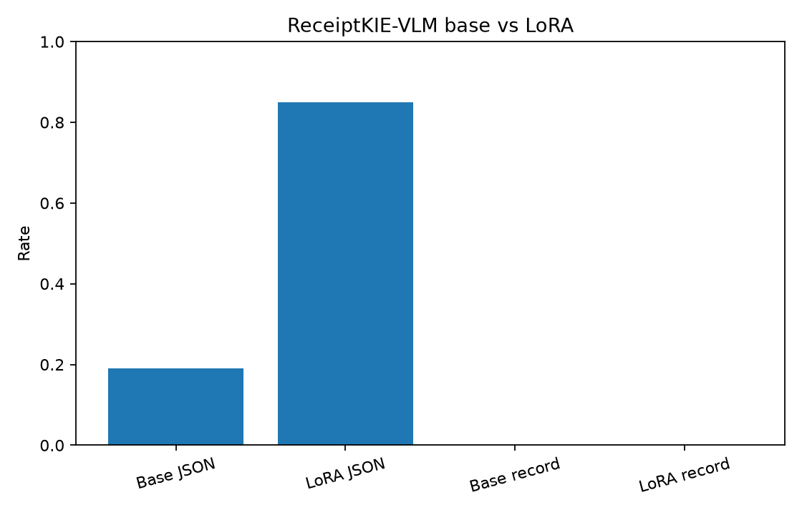

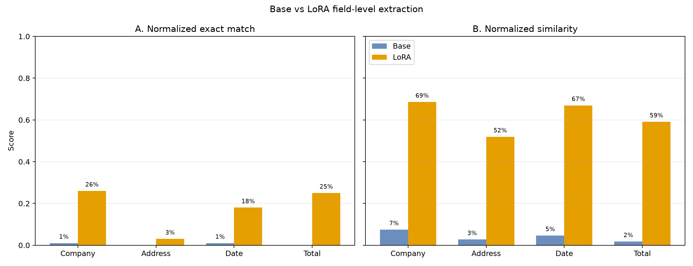

## Qualitative Results

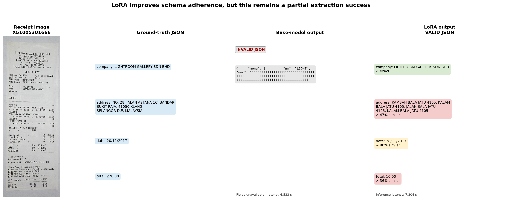

LoRA substantially improves schema adherence and JSON validity. The highlighted
example is deliberately labelled a **partial success**: at least one normalized
field is exact, but the receipt is not fully correct.

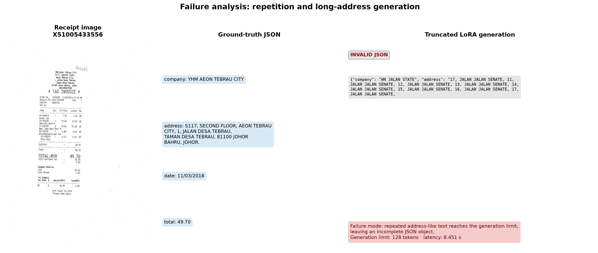

The failure panel keeps the raw generation visible. Repetition and long-address
generation can consume the 128-token budget and leave an incomplete JSON object.
The exact source IDs and unedited prediction values used in both figures are
recorded in
[`qualitative_results_manifest.json`](artifacts/reports/qualitative_results_manifest.json).
All predictions remain available as JSONL under `artifacts/predictions/`.

## Failure analysis

- In the historical V1 100-receipt evaluation, no receipt had all four
  normalized fields exactly correct. V2 improves this substantially but remains
  a research prototype, not a production extractor.
- Fifteen LoRA generations were invalid JSON. Inspection shows long repeated
  address-like text reaching the generation cap rather than a parser defect.
- Address is the hardest exact-match field because it is long and sensitive to
  small OCR substitutions, ordering, and punctuation. Similarity improves
  substantially even while exact match remains 3%.
- The adapter is slower than base because its outputs are more structured but
  often longer.
- The 256M model and 512 px downscaling trade fine-print recognition for local
  training feasibility.

## Pilot robustness benchmark

A paired 20-receipt pilot evaluated the LoRA model on clean images and four mild
deterministic corruptions. Because this is a small subset, differences are
descriptive rather than statistically definitive.

| Condition | Valid JSON | Company acc. | Address sim. | Date acc. | Total acc. |
|---|---:|---:|---:|---:|---:|
| Clean | 85% | 25% | 57.51% | 25% | 5% |
| Gaussian blur (radius 1.2) | 80% | 15% | 52.60% | 25% | 5% |
| JPEG quality 45 | 95% | 25% | 61.53% | 25% | 5% |
| Brightness 0.65× | 85% | 10% | 53.69% | 20% | 5% |
| Rotation up to ±3° | 90% | 25% | 55.81% | 15% | 5% |

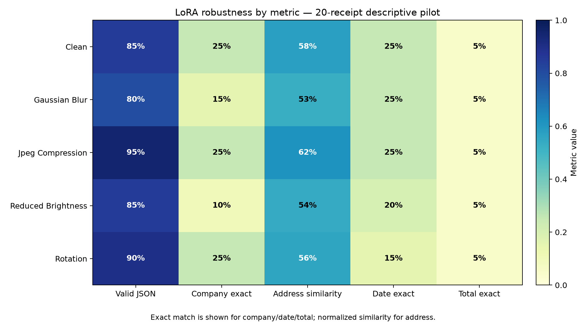

## Reproduction

Python 3.11 or newer is supported. An NVIDIA CUDA environment is recommended on Windows for faster inference and training, but the demo also runs on CPU.

```powershell
python -m venv .venv
.\.venv\Scripts\python.exe -m pip install --upgrade pip
.\.venv\Scripts\python.exe -m pip install -r requirements-dev.txt
.\.venv\Scripts\python.exe -m pip install --no-deps -r requirements-gpu.txt
.\.venv\Scripts\python.exe scripts\preflight.py
```

Place SROIE2019 under `data/raw/sroie/SROIE2019`, then audit, smoke-test, train,
and evaluate:

```powershell
.\.venv\Scripts\python.exe scripts\prepare_dataset.py
.\.venv\Scripts\python.exe -m pytest -q
.\.venv\Scripts\ruff.exe check src\receipt_kie scripts tests
.\.venv\Scripts\python.exe scripts\run_smoke_test.py
.\.venv\Scripts\python.exe scripts\run_training.py --config configs\train_lora.yaml
.\.venv\Scripts\python.exe scripts\run_evaluation.py --config configs\evaluate.yaml
.\.venv\Scripts\python.exe scripts\run_evaluation.py --config configs\evaluate_v1.yaml
.\.venv\Scripts\python.exe scripts\run_robustness.py --config configs\evaluate.yaml
.\.venv\Scripts\python.exe scripts\build_report.py
```

The base model downloads into `.cache/huggingface/`. Exact successful environment
versions are recorded in `requirements-lock.txt`. The default demo does not read
the dataset or any training checkpoint.

## Repository structure

```text
configs/                    Reproducible train/evaluation settings
src/receipt_kie/            Dataset, prompting, model, training, inference, metrics
scripts/                    Preflight, audit, train, evaluate, report, integrity CLIs
tests/                      Focused unit tests
research_notebooks/         Preserved upstream research notebooks
data/                       Git-ignored raw and derived datasets
models/receipt-kie-lora/    Preserved V1 historical adapter
models/receipt-kie-lora-v2-highres/  Recommended V2 adapter
artifacts/
  checkpoints/              Local trainer state and intermediate checkpoints (Git-ignored)
  figures/                  Generated plots
  predictions/              Auditable JSONL and curated receipt examples
  reports/                  Audits, metrics, comparisons, integrity check
```

## Ethical and data-use considerations

Receipts can contain sensitive financial or location information. Use only data
whose licence and consent permit the intended processing; avoid uploading raw
private receipts; restrict access to prediction artifacts; and evaluate across
languages, layouts, scan quality, and merchant types before any consequential
use. Generated values can be wrong and should not drive payment, accounting, or
compliance decisions without validation.

