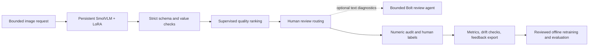

# ReceiptOps runbook and model card

ReceiptOps turns the original receipt KIE experiment into a testable ML service
prototype. It separates extraction accuracy, output validity, ranking quality,
operational reliability, and human review. None is a substitute for another.



## Reproduce the evidence

Use the existing project virtual environment and Python 3.11 or 3.12:

```powershell
python -m pip install -r requirements-api.txt -r requirements-structured.txt
python scripts/audit_data_quality.py
python scripts/reanalyze_content_disjoint.py
python scripts/train_quality_gate.py
python scripts/build_quality_report.py
```

The audit command deliberately exits 1 when it finds cross-split image copies.
That is an actionable data-quality failure, not a script crash. The following
reanalysis consumes the recorded exclusions without changing raw data, adapters,
historical predictions, or labels. The raw SROIE dataset is needed for the audit;
the committed audit and prediction files suffice for the offline reanalysis and
quality-classifier reproduction.

### Content-leakage correction

The audit examined 626 official-train and 347 official-test images. It found seven
exact image-content groups spanning the official splits, five duplicate groups
within train, three within test, and one training annotation missing `address`.
The original 563/63 train/validation partition has no exact-content overlap;
duplicate images inside its training portion are still a data-quality issue.

Seven of the historical 246 evaluation IDs are removed: four duplicate training
images, two duplicate earlier test-development images, and one is a repeated
image inside the evaluation set. Selection uses only content hashes and prior
usage, never model correctness. The remaining 239 are a retrospective,
content-disjoint subset. They have already been evaluated; they are not a new
unseen test set. Exact hashes cannot detect all perceptual duplicates or model
pretraining contamination.

V2 macro normalized exact match is 63.1% versus V1's 43.8%; the paired 2,000-draw
bootstrap interval for the 19.25 percentage-point difference is approximately
16.00–22.39 points. V2 complete-record exact match is 18.4%. Most records still
contain at least one error. Historical 246-ID reports are preserved, with notices
pointing to the corrected analysis.

### Quality model and imbalanced labels

The binary label is whether all four fields match after existing normalization.
The quality model receives only features available at inference: schema validity,
missing/invalid values, string lengths, digit ratios, company/address overlap,
repetition, and token-limit state. It never receives ground truth, sample IDs,
merchant identities, or entity paths as features.

Of 63 original V2 validation predictions, one record with an incomplete address
annotation is quarantined pending review. The remaining 62 are split, with
stratification and seed 42, into 46 classifier-fit and 16 threshold-calibration
records. Standardization is fit only on the 46. Both ordinary and inverse-frequency class-weighted logistic
regression use fixed C=1.0. The balanced variant is the declared experiment, not
a model picked by test scores. Numeric coefficients/scaling are exported as JSON,
with a content-addressed version; runtime inference does not unpickle artifacts.
The exporter verifies agreement with scikit-learn's scores.

On the content-disjoint retrospective 239 records, 44 are fully correct and 195
contain at least one mismatch. Balanced logistic average precision is 0.275,
unweighted logistic is 0.277, and the prevalence baseline is 0.184. Their near
equality does not demonstrate a meaningful benefit from class weighting here.
The balanced model's ROC AUC is approximately 0.664.

The routing policy requires empirical calibration precision >=80% with at least
three accepted calibration records. The selected candidate accepts five
calibration records, four correctly (80%), but accepts 81 evaluation records,
only 30 correctly (37.0%). This is a failed generalization result: 51 would be
false acceptances. The candidate threshold is retained for audit, and
`deployment_allowed=false` forces all service outputs to review. Training does
not authorize model promotion. Do not describe the deployed review-only policy
as 100% acceptance precision or automated extraction success.
The model is a small-data ranking experiment, not a calibrated confidence model.

Hard checks independently force review for schema/value issues, duplicate
company/address text, and a changed image-processor configuration. The API defaults
to 1024 px to fit this laptop. The quality model's feature training used 1536 px;
the configuration mismatch is exposed and cannot silently permit acceptance.
The real synthetic API example also demonstrates why a high model score cannot
override these rules: the model misreads the address as the merchant.

## Run the API locally

From the project root in an activated environment:

```powershell
$env:PYTHONPATH = "src"
$env:RECEIPT_API_KEY = "replace-with-a-local-secret"
$env:RECEIPT_IMAGE_EDGE = "1024"
python -m receipt_kie.service
```

The server loads one V2 model during startup, binds to 127.0.0.1:8000, and permits
one in-flight inference. Excess inference receives 429 with Retry-After instead
of starting another GPU model. The admission slot remains held until background
inference finishes if a client disconnects. Startup failures do not announce
readiness. The server returns 503 on inference errors and removes request files.

Send raw PNG/JPEG bytes (no multipart or server-side image path):

```powershell
curl.exe http://127.0.0.1:8000/v1/extract -H "X-API-Key: $env:RECEIPT_API_KEY" -H "Content-Type: image/png" --data-binary "@assets/demo/synthetic_receipt.png"
```

| Endpoint | Purpose |
|---|---|
| `GET /health/live` | Process liveness |
| `GET /health/ready` | Model-loaded readiness |
| `POST /v1/extract` | Bounded extraction, schema checks, quality routing |
| `POST /v1/feedback` | Four strict boolean correctness labels for a request ID |
| `GET /v1/monitoring` | Windowed validity, review, latency, feedback and feature drift |
| `GET /metrics` | Prometheus counters and latency histogram |

Operational endpoints use X-API-Key when configured, except health checks.
Non-loopback binding via the CLI requires a key. Terminate TLS and apply rate
limits at a gateway before network exposure. Interactive API documentation is
available at `/docs`; no receipts or tokens are embedded in it.

Feedback example:

```json
{"request_id":"UUID_FROM_EXTRACTION","correct_fields":{"company":false,"address":true,"date":true,"total":true}}
```

Identical repeated feedback is idempotent; conflicting labels receive 409. The
local audit stores numeric features, decisions, timing, model versions, and
correctness labels, not receipt images, raw text, or extracted addresses. Store
access and retention still need controls; numeric features can be sensitive too.
Export labels explicitly:

```powershell
python scripts/export_feedback.py --output .cache/feedback/labeled_features.jsonl
```

This is a collection/export loop. No automatic self-training or production
promotion occurs. A future retraining job needs new group-disjoint fit/calibration
and evaluation data, annotation checks, and a reviewed promotion decision.

Drift uses fit-only feature quantile bins and smoothed PSI over the latest 500
records of the current quality-model version, starting at 30 observations. PSI
>0.2 is an investigation heuristic, not a significance test or proof of accuracy
loss. Feedback coverage is reported alongside labeled accuracy because voluntary
feedback is selection-biased. Output slices examine digit-heavy company text,
company/address overlap and predicted address length; they do not establish
demographic fairness. SROIE has no appropriate protected-group labels for that.

## Bolt E4B integration

Verified official model: `nvidia/NVIDIA-Nemotron-3.5-Bolt-E4B-4GB`, revision
`1db54d5b12533ff1bcaa8e42cf4c667988a1f1be`. NVIDIA's model card declares text/text,
Q4_K_M, 8B total/4B effective parameters and a 64K context limit. Unsloth quotes
approximately 4GB VRAM **plus system RAM**, with a 6.18GB weight download. This
does not mean 64K context or fine-tuning fits a 4GB laptop GPU. Another distribution
includes vision projectors, but direct receipt-vision capability needs a separate
verified test. The official text checkpoint is not substituted for SmolVLM here.

The review agent uses a llama.cpp-compatible chat endpoint. It is bounded to
one allowed read-only `inspect_receipt` tool call and one JSON-schema-constrained
review/abstain decision, each at most 256 generated tokens. It has no shell,
filesystem, web, approval, or receipt-editing tools. Invalid output, a forbidden
tool, a reached token budget, or an unavailable endpoint causes abstention.
It cannot validate image evidence or raise the extractor's acceptance action.
Deterministic temperature 0 is an experimental review setting; NVIDIA's general
chat recommendation is temperature 1.0/top_p 0.95.

Check this machine and an explicitly started local server:

```powershell
python scripts/bolt_preflight.py
python scripts/bolt_review.py --predictions artifacts/experiments/highres_training_v2/v2_predictions.jsonl --sample-id X00016469670 --base-url http://127.0.0.1:8081
```

Use the official NVIDIA/Unsloth deployment guide for model installation. Start
with a 2048–4096-token context, one slot, no drafter, and conservative offloading;
measure actual memory before expanding context. For a compatible `llama-server`:

```powershell
llama-server -m models/nemotron-bolt/Nemotron-3.5-Bolt-E4B-Q4_K_M.gguf --alias nemotron-bolt --host 127.0.0.1 --port 8081 --ctx-size 2048 --parallel 1 --jinja
```

Enable optional review in the main service by setting `RECEIPT_BOLT_URL` to that
endpoint. Receipt text is sent to the configured endpoint; keep it local for this
prototype. Live CPU results are recorded under `artifacts/experiments/receiptops/`.
The corrected schema request completed one tool/abstention cycle. Earlier invalid
protocol runs remain recorded. The request uses nested
`response_format.json_schema.schema`, verified against b11459's parser, and
`reasoning_effort: none`; a template keyword alone did not disable reasoning.

### Experimental CPU OCR to Bolt challenger

The optional image challenger uses RapidOCR/ONNX on CPU to read pixels, then
sends only its recognized text to Bolt for schema-constrained company/address/
date/total extraction. This avoids assuming vision support in the official text
checkpoint and supplies evidence beyond the original VLM's four predictions.
OCR errors can still propagate, and this backend is not approved for deployment.

```powershell
python -m pip install -r requirements-ocr.txt
python scripts/ocr_bolt_inference.py --image assets/demo/synthetic_receipt.png --output artifacts/experiments/receiptops/ocr_bolt_demo.json
python scripts/compare_ocr_bolt.py --limit 3
```

The comparison fixes the first three sorted IDs from the existing ten-receipt
**original-validation** pilot before the challenger runs. It uses actual images
and CPU OCR, not oracle dataset transcripts, and no reference annotations enter
the model context. It compares against saved V2 predictions on those same
original images; backend preprocessing differs. Outputs, OCR evidence and timing
are saved separately. It is a development probe, not the 239-record evaluation
or evidence of generalization. Even schema-valid challenger outputs require
review; the V2 quality ranker is not calibrated for this new backend.

RapidOCR is an additional pretrained model, not a custom model trained in this
repository. Its per-line confidence is diagnostic rather than calibrated receipt
accuracy. Empty OCR evidence abstains without asking Bolt to invent a receipt;
HTTP/model/schema errors stay in the evaluation denominator as invalid outputs.

The actual three-bill CPU pilot is complete: macro exact 25.0% for saved V2
versus 33.3% for OCR + Bolt; complete-record exact 0/3 for both. One challenger
request exhausted its 256-token output budget. Read [BOLT_PILOT.md](BOLT_PILOT.md)
for every sample, failures, protocol correction and hardware limits. These are
development results, not evidence to promote the new backend.

## Deploy and verify

```powershell
python -m pip install -r requirements-dev.txt
pytest -q -p no:cacheprovider
ruff check src scripts tests
python scripts/smoke_service.py
```

The smoke command uses the real model for one fictional receipt through the ASGI
app, and saves measured results. It is not a network/load benchmark. Contract
tests inject a simulated predictor to test errors and concurrent overload without
claiming GPU throughput. The GitHub Actions workflow runs those tests on CPU and
reproduces the quality model from committed predictions.

With Docker and the NVIDIA Container Toolkit installed, build the supplied
Dockerfile and run with a mounted `/state` directory, a configured API key and GPU
access. Hugging Face base weights download into the mounted state cache on first
startup. The image uses a non-root UID and ships only inference artifacts.

`deploy/ecs-task.template.json` is an AWS ECS EC2 GPU task blueprint with secret
injection and readiness health checks. Replace every `REPLACE_WITH_...` value,
use an IAM execution role limited to ECR/logs/the named secret, and place it behind
a private load balancer/TLS gateway. It has no persistent state volume: task
replacement loses local feedback. Provision managed persistent storage before
real use. Neither Docker nor cloud deployment is claimed as executed here.

SQLite WAL and one GPU worker make this a single-replica prototype. Before
horizontal scaling, move feedback/audits to a transactional managed database,
add an authenticated queue and idempotent jobs, isolate stateless API replicas
from a batched inference service, then measure p50/p95/p99, failures, queue delay,
GPU utilization, and cost under representative traffic. This laptop demo
does not establish thousands-of-requests-per-second capacity.

## Primary references

- [NVIDIA E4B official model card](https://huggingface.co/nvidia/NVIDIA-Nemotron-3.5-Bolt-E4B-4GB)
- [Unsloth Bolt memory and runtime guide](https://unsloth.ai/docs/models/nemotron-3.5-bolt)
- [llama.cpp server schema and tool support](https://github.com/ggml-org/llama.cpp/tree/master/tools/server)
- [scikit-learn metrics](https://scikit-learn.org/stable/modules/model_evaluation.html)
- [FastAPI lifespan and tests](https://fastapi.tiangolo.com/advanced/testing-events/)
- [RapidOCR upstream](https://github.com/RapidAI/RapidOCR)
