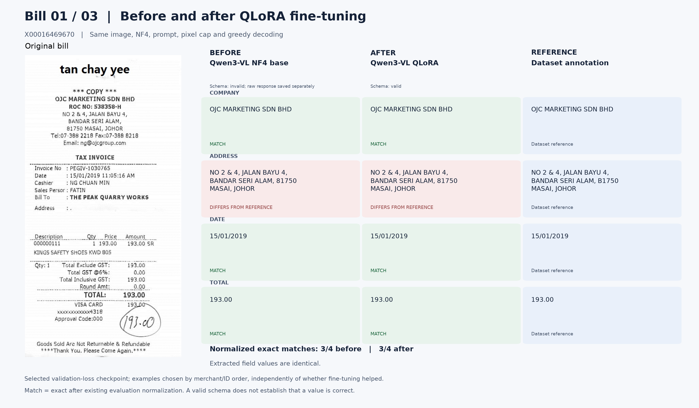
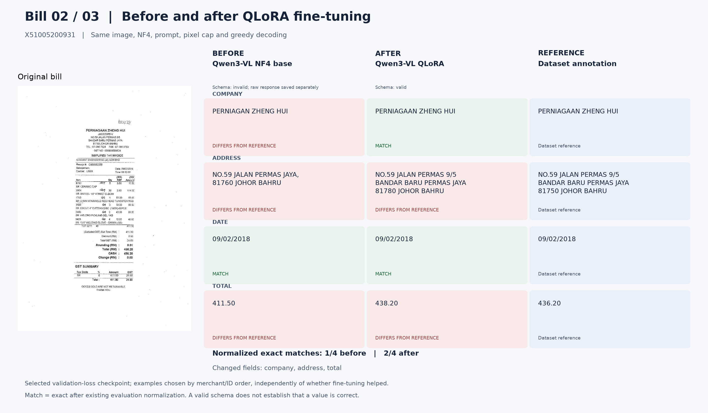
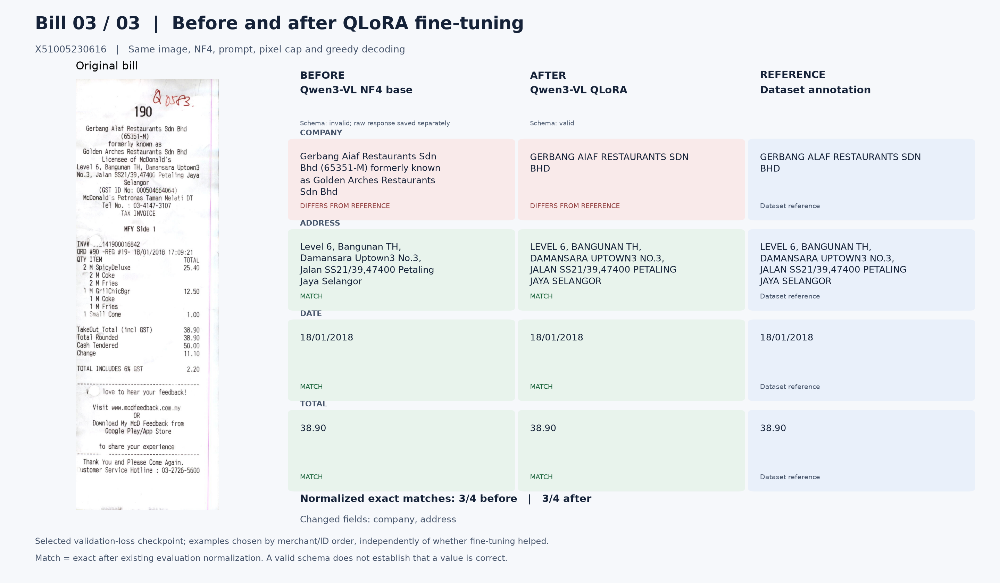

# Bill-by-bill Qwen comparison

Selection: first three distinct normalized merchants in lexicographic evaluation-ID order, independent of model outcomes. These examples are not an accuracy estimate.

Before = pinned NF4 base; after = selected QLoRA adapter. The image, prompt, pixel cap and decoding are identical. Colors compare normalized values with dataset annotations; annotations can contain errors.

## Bill 1: X00016469670

## Bill 2: X51005200931

## Bill 3: X51005230616

