# ReceiptOps output differences: 14 documented cases

Original receipt → saved baseline output → latest Qwen QLoRA output → dataset reference.

## How to read this gallery

These are outcome-selected examples, not a representative sample or an accuracy estimate. Each comparison has seven declared buckets: several fields recovered, total/date/merchant/address correction, unchanged fields, and a regression. Within each bucket select the first lexicographic evaluation ID that has not been used; keep distinct normalized merchants within each comparison. All 14 bills are unique.

V2 versus Qwen compares project versions with different preprocessing and prompts. Qwen base versus QLoRA keeps images, NF4, prompt, pixel cap and decoding identical. All panels use the same tolerant parser for fields; strict schema is labeled separately. Reference labels can contain mistakes.

## Outcomes across all 239 receipts

| Comparison | More correct fields | Equal correct-field count | Fewer correct fields |
|---|---:|---:|---:|
| Legacy V2 → QLoRA | 167 | 66 | 6 |
| Qwen NF4 base → QLoRA | 78 | 151 | 10 |

Equal counts do not imply identical predictions. The two comparisons have respectively 40 and 138 bills with identical normalized field values.

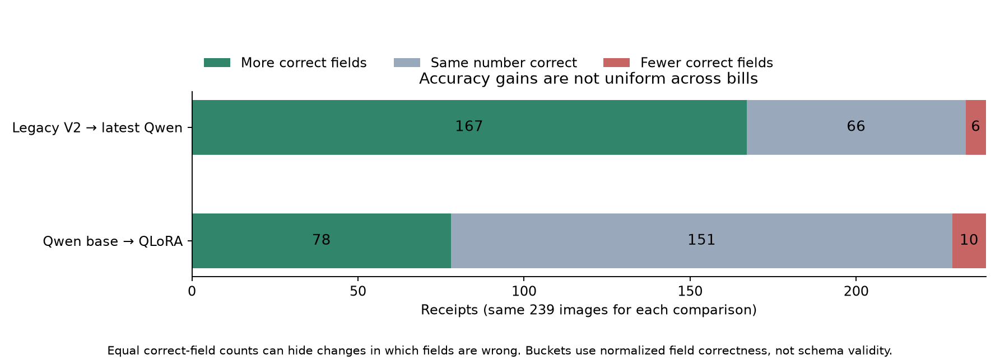

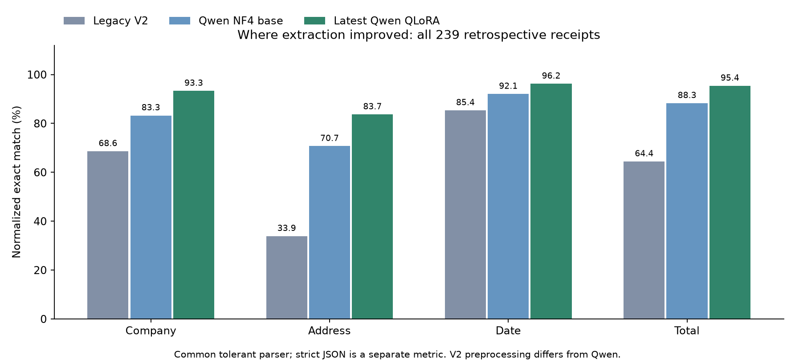

## 01. Legacy V2 → QLoRA: Several fields recovered

Receipt `X51005230657`. Normalized correct fields: **2/4 → 4/4**. Changed fields: address, total. Eligible cases before diversity filtering: 71.

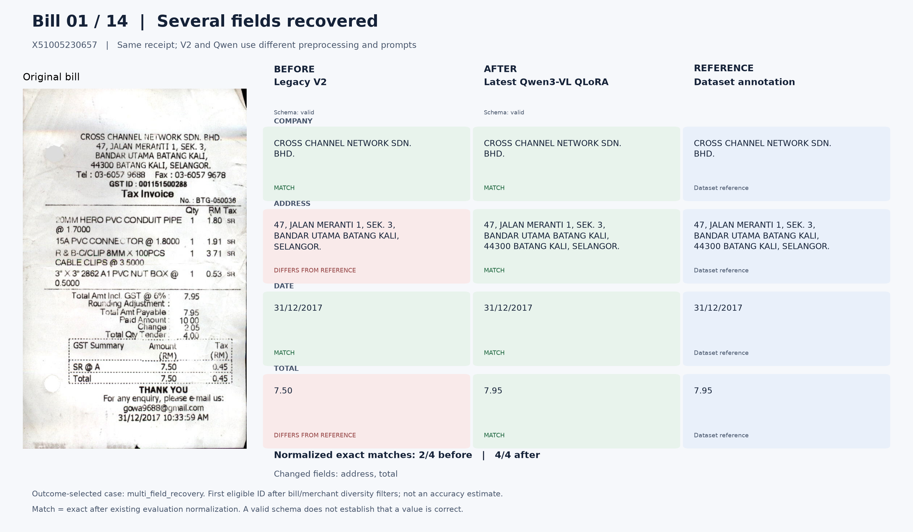

## 02. Legacy V2 → QLoRA: Total corrected

Receipt `X51005268408`. Normalized correct fields: **2/4 → 4/4**. Changed fields: company, total. Eligible cases before diversity filtering: 77.

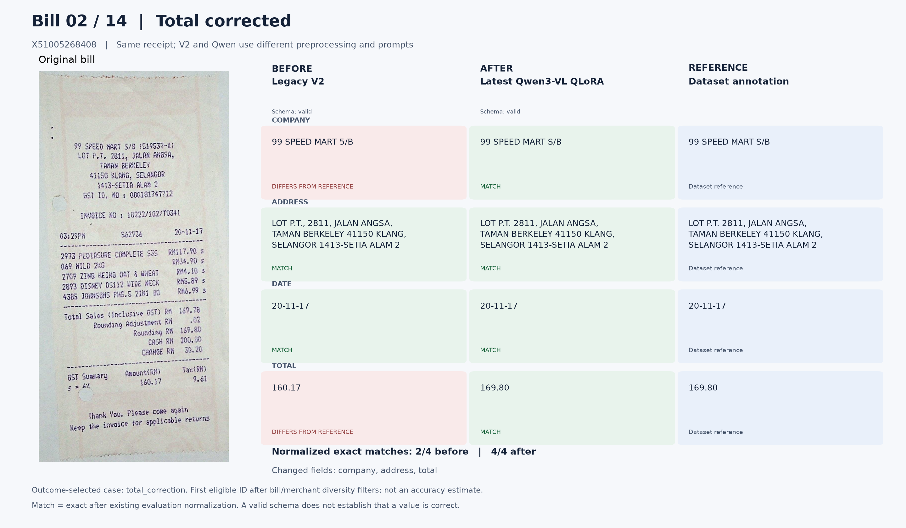

## 03. Legacy V2 → QLoRA: Date corrected

Receipt `X51005200931`. Normalized correct fields: **0/4 → 2/4**. Changed fields: company, address, date, total. Eligible cases before diversity filtering: 28.

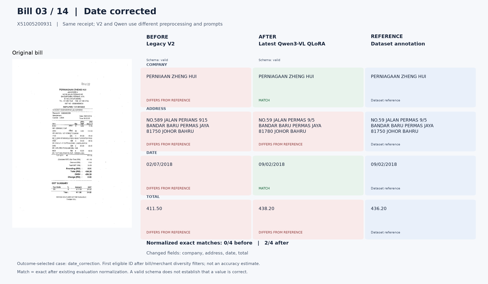

## 04. Legacy V2 → QLoRA: Merchant corrected

Receipt `X51005337877`. Normalized correct fields: **2/4 → 4/4**. Changed fields: company, total. Eligible cases before diversity filtering: 61.

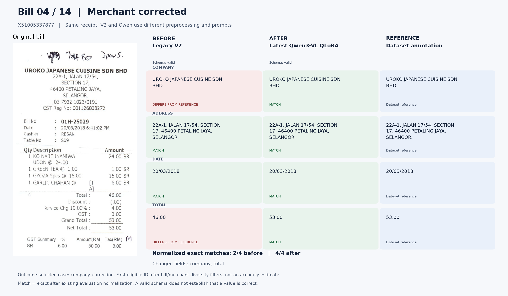

## 05. Legacy V2 → QLoRA: Address corrected

Receipt `X51005230616`. Normalized correct fields: **1/4 → 3/4**. Changed fields: company, address, date. Eligible cases before diversity filtering: 120.

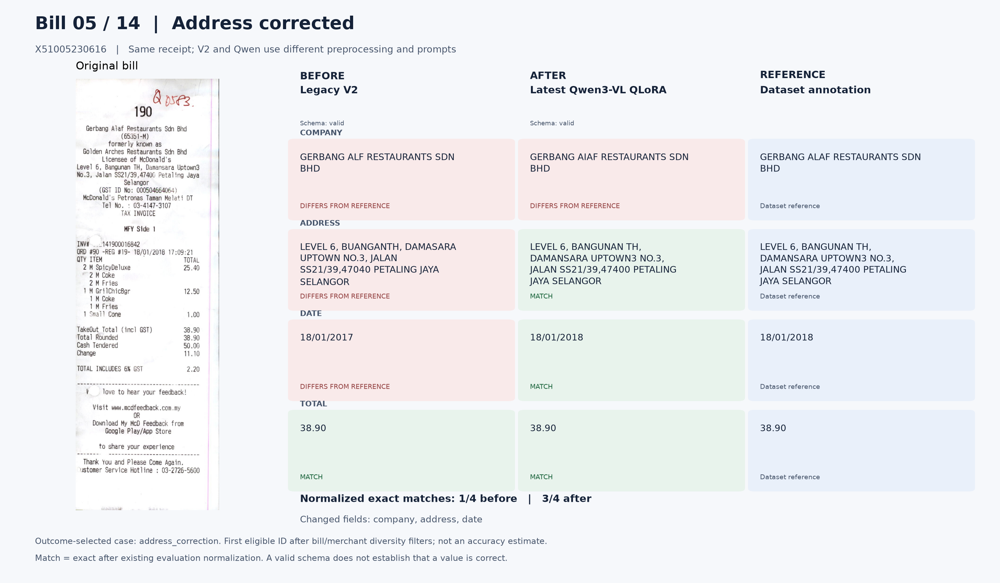

## 06. Legacy V2 → QLoRA: Extracted fields unchanged

Receipt `X00016469671`. Normalized correct fields: **4/4 → 4/4**. Changed fields: none. Eligible cases before diversity filtering: 40.

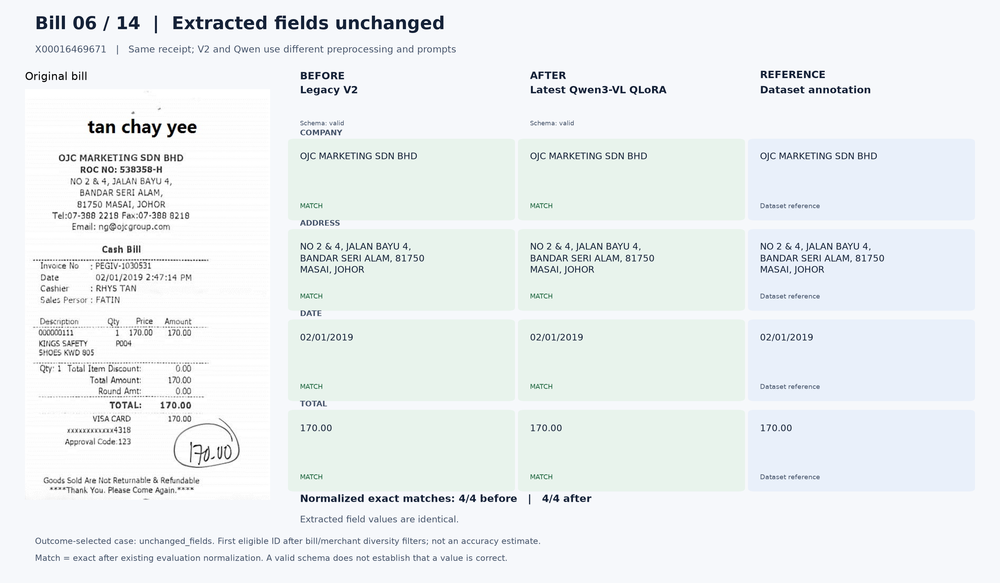

## 07. Legacy V2 → QLoRA: Fewer correct fields after the upgrade

Receipt `X51005724628`. Normalized correct fields: **4/4 → 3/4**. Changed fields: company. Eligible cases before diversity filtering: 6.

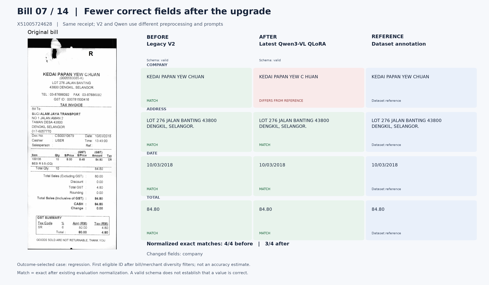

## 08. Qwen NF4 base → QLoRA: Several fields recovered

Receipt `X51005705729`. Normalized correct fields: **2/4 → 4/4**. Changed fields: address, total. Eligible cases before diversity filtering: 12.

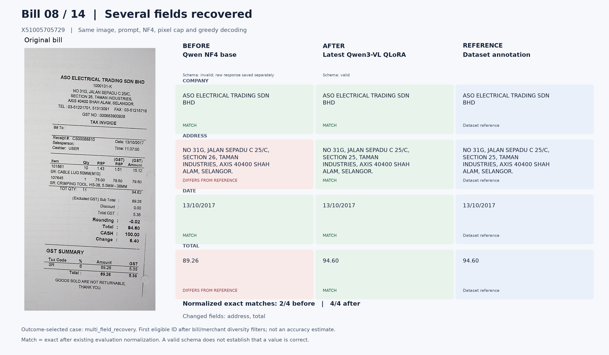

Visual annotation discrepancy: the printed address appears to say SECTION 26, while the reference says SECTION 25. The adapter's address matches the reference, but the base matches the visible text. Green cells mean reference agreement. The 89.26 to 94.60 total correction is visible on the bill. Original references are preserved and benchmark scores are unchanged.

## 09. Qwen NF4 base → QLoRA: Total corrected

Receipt `X51005230648`. Normalized correct fields: **3/4 → 4/4**. Changed fields: total. Eligible cases before diversity filtering: 18.

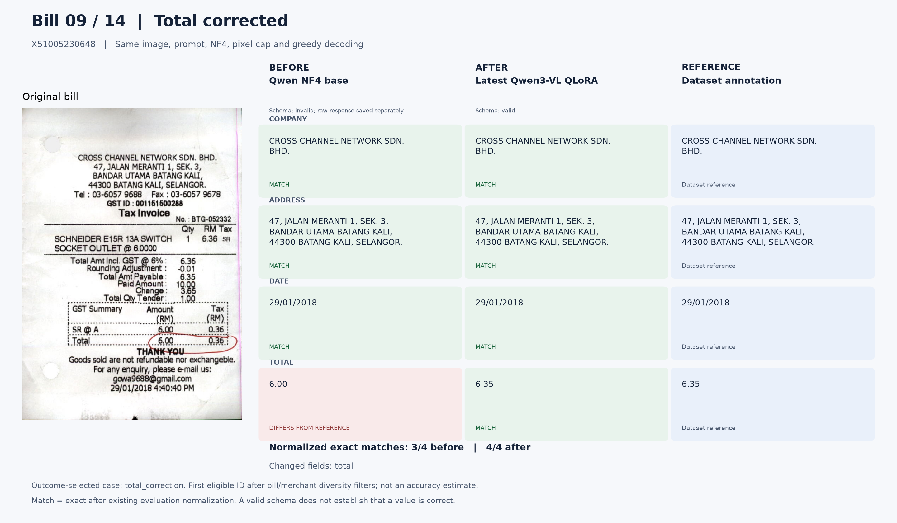

## 10. Qwen NF4 base → QLoRA: Date corrected

Receipt `X51005568866`. Normalized correct fields: **2/4 → 3/4**. Changed fields: date. Eligible cases before diversity filtering: 9.

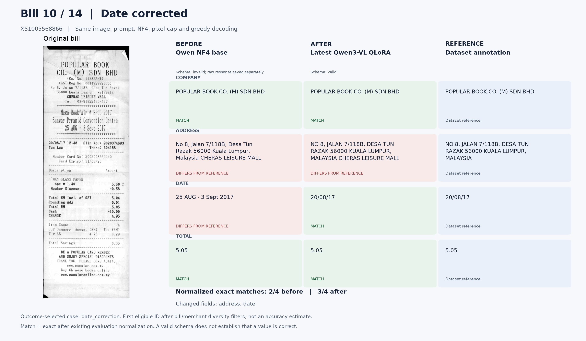

## 11. Qwen NF4 base → QLoRA: Merchant corrected

Receipt `X51005447844`. Normalized correct fields: **2/4 → 3/4**. Changed fields: company, address. Eligible cases before diversity filtering: 26.

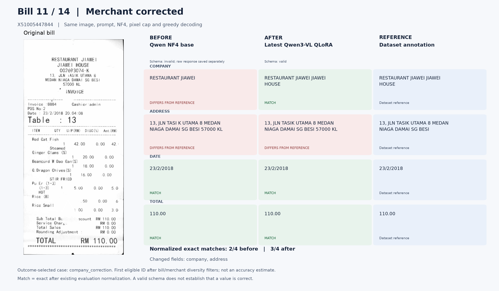

## 12. Qwen NF4 base → QLoRA: Address corrected

Receipt `X51005433543`. Normalized correct fields: **2/4 → 3/4**. Changed fields: address. Eligible cases before diversity filtering: 40.

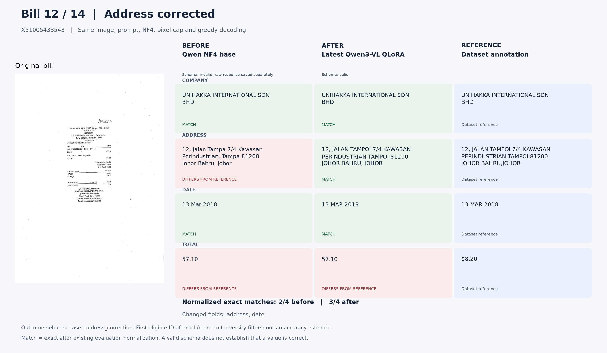

## 13. Qwen NF4 base → QLoRA: Extracted fields unchanged

Receipt `X00016469670`. Normalized correct fields: **3/4 → 3/4**. Changed fields: none. Eligible cases before diversity filtering: 138.

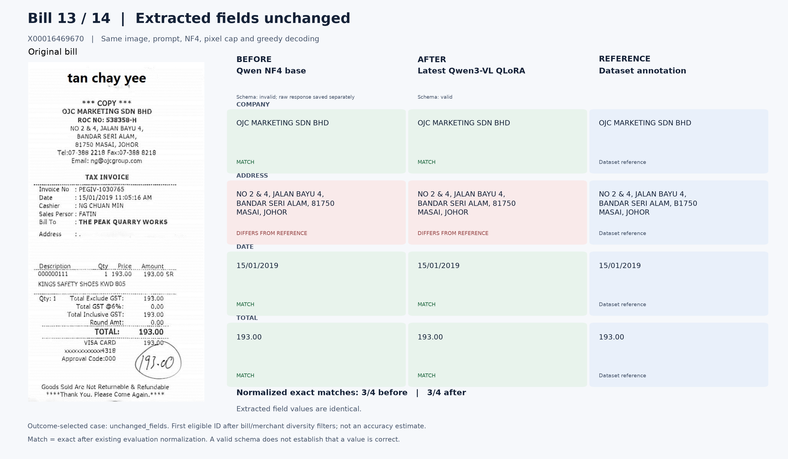

## 14. Qwen NF4 base → QLoRA: Fewer correct fields after the upgrade

Receipt `X51005230621`. Normalized correct fields: **4/4 → 3/4**. Changed fields: address. Eligible cases before diversity filtering: 10.

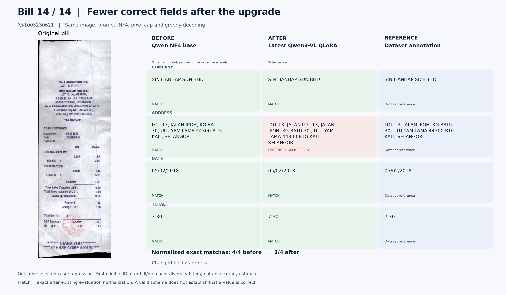
